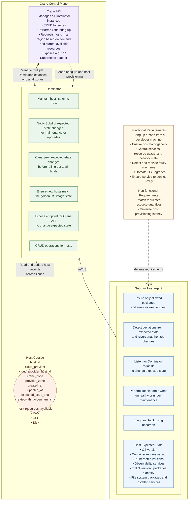

# Crane architecture review

My overall assessment: this is a meaningful improvement in the separation between Crane's control plane and the Kubernetes interface, but a few responsibilities and state-management boundaries need to be tightened before you implement it.

The strongest part of the updated design is that application developers interact with Kubernetes, while the Crane-API team owns the infrastructure lifecycle underneath it. Dominator manages zone-level host capacity, Subd enforces host state, and the Host Catalog provides a cross-zone view of the fleet.

That is a good foundation for a platform that provisions infrastructure automatically without requiring every application team to understand Crane.

I'll review the design against your stated functional and non-functional requirements, with particular attention to zone placement, autoscaling, host reconciliation, and the Kubernetes adapter.

## 1. What the architecture gets right

1\. Kubernetes remains the developer-facing abstraction

The Crane-API team's Kubernetes adapter is a good boundary. Application teams should submit ordinary Kubernetes workloads and resource requests; they shouldn't need to call Dominator, select cloud instances, or understand provider-specific provisioning.

2\. Subd owns host-level enforcement

Subd continuously compares actual host state with expected state, repairs drift, and handles maintenance drains. This is a good separation from Dominator's fleet-level decisions. The distinction between deciding what capacity is needed and enforcing what a host should look like is essential.

3\. A cross-zone Host Catalog provides a foundation for placement

Tracking cloud-provider IDs, Crane zones, provider zones, expected-state versions, and available resources is a reasonable starting point for answering: "Where can this workload run, and where should additional capacity be created?"

4\. Declarative host reconciliation supports automated recovery

The expected host state, golden-image version, and Subd reconciliation loop establish a foundation for repeatable provisioning, drift correction, and OS upgrades rather than relying on one-off SSH scripts.

## 2. The most important architectural issues

P0

Who owns the global capacity decision?

The diagram shows Dominator instances maintaining hosts within their zones and a shared Host Catalog across zones. It does not yet show a clearly authoritative component deciding which zone should receive capacity, when capacity should be added, and how much.

If every Dominator independently decides to scale, two zones may react to the same demand or scale without considering global placement constraints.

Recommendation: Introduce a logically centralized placement and capacity policy in Crane-API, or a dedicated global capacity controller. Keep provisioning and host lifecycle execution in Dominator. Start with one authoritative decision-maker rather than distributing global policy across Dominator instances.

P0

The Host Catalog must distinguish available capacity from allocated capacity

`host_resources_available` is not enough to determine whether a host can accept another workload. A host might have free CPU and memory but be draining, unhealthy, reserved, or already committed to workloads whose resource requests haven't yet appeared in actual utilization.

Recommendation: Track at least:

- Total allocatable CPU, memory, and ephemeral storage.
- Allocated/requested resources, including pending scheduling commitments.
- Observed utilization separately from reserved capacity.
- Host lifecycle state, health, schedulability, and drain state.
- Last heartbeat and last successful reconciliation.

Make placement decisions using allocatable capacity minus reservations, not raw observed free resources.

P0

The Kubernetes adapter needs a precise integration contract

The diagram says Crane exposes a gRPC Kubernetes adapter. That describes a transport, but not how Kubernetes will react when capacity is missing.

A gRPC endpoint by itself does not make Kubernetes automatically provision new machines. The design must specify which Kubernetes extension triggers the scale-up decision and how it works with the scheduler.

Recommendation: For a scale-from-zero or unschedulable-pod workflow, use a Kubernetes-compatible autoscaling integration, such as a custom cluster autoscaler/cloud-provider integration or a controller that reacts to unschedulable Pods. Define how it:

- Detects pending workloads.
- Determines the required resource shape and eligible zones.
- Requests capacity from Crane.
- Reports capacity that is being provisioned.
- Prevents repeated scale-up requests for the same demand.

Developers should still see normal Kubernetes objects and scheduling behavior.

P1

The Host Catalog needs a clear source of truth

A shared catalog across zones is useful, but it creates consistency questions. What happens if Dominator creates a host and crashes before updating the catalog? What if a host is terminated in the cloud but its record still says it's available?

Recommendation: Treat the catalog as a durable control-plane inventory with explicit lifecycle transitions. Cloud-provider observations, Dominator's desired operations, and Subd's host reports should be reconciled into that inventory. Use idempotent operations and periodic repair for missed updates.

P1

Golden-image rollout needs versioned desired state

The diagram mentions updating the golden image before rolling out a change and ensuring newly created instances use the latest image. That is a sound objective, but "latest" is an ambiguous target during a rollout.

Recommendation: Pin each rollout to an immutable image ID or digest and a desired-state version. Dominator should track rollout progress, while Subd enforces the host's assigned version. New instances should use the version assigned to their zone's rollout policy, not simply whichever image is currently latest.

## 3. Component-by-component review

### Crane-API

Keep: The single public infrastructure interface, zone lifecycle operations, and Kubernetes-facing integration.

Change: Avoid making Crane-API a large synchronous orchestrator that provisions every resource directly. It should own policy and workflow coordination while long-running infrastructure operations execute asynchronously.

I'd define these responsibilities:

- Accept Kubernetes-originated capacity requests.
- Determine eligible zones based on resource availability, constraints, and policy.
- Select a target zone and calculate the required capacity.
- Persist a provisioning request before dispatching it.
- Track the request through provisioning, registration, readiness, and failure.
- Expose zone and capacity status to the Kubernetes integration.

For long-running work, an API response should mean "request accepted," not "host is ready." A request ID and observable status are more useful than holding a gRPC call open throughout cloud provisioning.

### Dominator

Dominator should be a zone-scoped fleet controller, not the global authority on placement across all zones.

Its core responsibilities should be:

- Maintain the desired capacity and host inventory for its assigned zone.
- Provision, register, and terminate hosts through the cloud-provider abstraction.
- Apply host lifecycle and golden-image rollout policies.
- Track in-flight operations and retry recoverable failures.
- Publish authoritative zone-level status to the control plane.

The diagram's note about multiple Dominator instances existing across zones is fine, but I would distinguish two concepts: multiple independent zone controllers and multiple replicas of the same zone controller. The latter need leader election, partitioning, or another explicit ownership mechanism so two replicas do not independently execute conflicting operations for the same zone.

### Subd

Subd is well positioned as the node-level agent, but its responsibilities should be tightly bounded.

It should:

- Reconcile OS, runtime, Kubernetes, observability, and security configuration.
- Report actual host state and health.
- Execute approved maintenance actions, including cordon and drain workflows.
- Rejoin Kubernetes scheduling only after required health checks pass.
- Report its desired-state version and observed-state version.

Important distinction: Subd should not independently decide to uncordon a host just because it has recovered. It should do so only when the maintenance operation has completed and the host is authorized to return to service.

Also, "ensures only allowed packages and services exist" is broader than simple configuration management. Define whether this is an allowlist, package-state reconciliation, immutable-image enforcement, or a combination. Avoid accidentally removing packages required by emergency recovery or provider agents.

### Host Catalog

I'd make this a durable inventory with a documented state machine, not merely a table of host metadata.

A possible host record would include:

| Field                          | Purpose                                                                                |
| ------------------------------ | -------------------------------------------------------------------------------------- |
| `host_id`                      | Stable Crane-generated identity                                                        |
| `provider`, `provider_host_id` | Cloud resource identity                                                                |
| `crane_zone`, `provider_zone`  | Logical placement and physical location                                                |
| `lifecycle_state`              | Requested, provisioning, registering, ready, draining, terminating, terminated, failed |
| `health_state`                 | Healthy, degraded, unhealthy, unknown                                                  |
| `desired_state_version`        | Version of the configuration assigned to the host                                      |
| `observed_state_version`       | Version last successfully applied by Subd                                              |
| `allocatable_resources`        | Resources Kubernetes can schedule                                                      |
| `reserved_resources`           | Resources already committed to workloads                                               |
| `last_heartbeat_at`            | Freshness of host observations                                                         |
| `operation_id`                 | Current provisioning, upgrade, or termination operation                                |

You may keep your existing `expectedstate_sha` and `createdwith_goldenos_sha`, but those hashes should supplement explicit version and lifecycle metadata rather than replace it.

One more distinction: the catalog's reported available resources are a snapshot, not an atomic reservation. Placement must have a reservation or reconciliation mechanism to avoid multiple concurrent requests claiming the same remaining capacity.

## 4. Zone placement and autoscaling: the missing end-to-end flow

This is the most important area to resolve before implementing the architecture. The diagram currently shows the components, but not the complete control loop from a developer creating a workload to Crane adding and eventually removing capacity.

I recommend the following flow.

\#chatgpt-mermaid-\_r_1e1\_{font-family:-apple-system-body,ui-sans-serif,-apple-system,system-ui,Segoe UI,Helvetica,Apple Color Emoji,Arial,sans-serif,Segoe UI Emoji,Segoe UI Symbol;font-size:16px;fill:rgb(237, 237, 237);}@keyframes edge-animation-frame{from{stroke-dashoffset:0;}}@keyframes dash{to{stroke-dashoffset:0;}}#chatgpt-mermaid-\_r_1e1\_ .edge-animation-slow{stroke-dasharray:9,5!important;stroke-dashoffset:900;animation:dash 50s linear infinite;stroke-linecap:round;}#chatgpt-mermaid-\_r_1e1\_ .edge-animation-fast{stroke-dasharray:9,5!important;stroke-dashoffset:900;animation:dash 20s linear infinite;stroke-linecap:round;}#chatgpt-mermaid-\_r_1e1\_ .error-icon{fill:rgb(48, 48, 48);}#chatgpt-mermaid-\_r_1e1\_ .error-text{fill:rgb(237, 237, 237);stroke:rgb(237, 237, 237);}#chatgpt-mermaid-\_r_1e1\_ .edge-thickness-normal{stroke-width:1px;}#chatgpt-mermaid-\_r_1e1\_ .edge-thickness-thick{stroke-width:3.5px;}#chatgpt-mermaid-\_r_1e1\_ .edge-pattern-solid{stroke-dasharray:0;}#chatgpt-mermaid-\_r_1e1\_ .edge-thickness-invisible{stroke-width:0;fill:none;}#chatgpt-mermaid-\_r_1e1\_ .edge-pattern-dashed{stroke-dasharray:3;}#chatgpt-mermaid-\_r_1e1\_ .edge-pattern-dotted{stroke-dasharray:2;}#chatgpt-mermaid-\_r_1e1\_ .marker{fill:rgb(175, 175, 175);stroke:rgb(175, 175, 175);}#chatgpt-mermaid-\_r_1e1\_ .marker.cross{stroke:rgb(175, 175, 175);}#chatgpt-mermaid-\_r_1e1\_ svg{font-family:-apple-system-body,ui-sans-serif,-apple-system,system-ui,Segoe UI,Helvetica,Apple Color Emoji,Arial,sans-serif,Segoe UI Emoji,Segoe UI Symbol;font-size:16px;}#chatgpt-mermaid-\_r_1e1\_ p{margin:0;}#chatgpt-mermaid-\_r_1e1\_ .label{font-family:-apple-system-body,ui-sans-serif,-apple-system,system-ui,Segoe UI,Helvetica,Apple Color Emoji,Arial,sans-serif,Segoe UI Emoji,Segoe UI Symbol;color:rgb(237, 237, 237);}#chatgpt-mermaid-\_r_1e1\_ .cluster-label text{fill:rgb(237, 237, 237);}#chatgpt-mermaid-\_r_1e1\_ .cluster-label span{color:rgb(237, 237, 237);}#chatgpt-mermaid-\_r_1e1\_ .cluster-label span p{background-color:transparent;}#chatgpt-mermaid-\_r_1e1\_ .label text,#chatgpt-mermaid-\_r_1e1\_ span{fill:rgb(237, 237, 237);color:rgb(237, 237, 237);}#chatgpt-mermaid-\_r_1e1\_ .node rect,#chatgpt-mermaid-\_r_1e1\_ .node circle,#chatgpt-mermaid-\_r_1e1\_ .node ellipse,#chatgpt-mermaid-\_r_1e1\_ .node polygon,#chatgpt-mermaid-\_r_1e1\_ .node path{fill:rgb(9, 23, 44);stroke:rgb(31, 78, 148);stroke-width:1px;}#chatgpt-mermaid-\_r_1e1\_ .rough-node .label text,#chatgpt-mermaid-\_r_1e1\_ .node .label text,#chatgpt-mermaid-\_r_1e1\_ .image-shape .label,#chatgpt-mermaid-\_r_1e1\_ .icon-shape .label{text-anchor:middle;}#chatgpt-mermaid-\_r_1e1\_ .node .katex path{fill:#000;stroke:#000;stroke-width:1px;}#chatgpt-mermaid-\_r_1e1\_ .rough-node .label,#chatgpt-mermaid-\_r_1e1\_ .node .label,#chatgpt-mermaid-\_r_1e1\_ .image-shape .label,#chatgpt-mermaid-\_r_1e1\_ .icon-shape .label{text-align:center;}#chatgpt-mermaid-\_r_1e1\_ .node.clickable{cursor:pointer;}#chatgpt-mermaid-\_r_1e1\_ .root .anchor path{fill:rgb(175, 175, 175)!important;stroke-width:0;stroke:rgb(175, 175, 175);}#chatgpt-mermaid-\_r_1e1\_ .arrowheadPath{fill:rgb(175, 175, 175);}#chatgpt-mermaid-\_r_1e1\_ .edgePath .path{stroke:rgb(175, 175, 175);stroke-width:1px;}#chatgpt-mermaid-\_r_1e1\_ .flowchart-link{stroke:rgb(175, 175, 175);fill:none;}#chatgpt-mermaid-\_r_1e1\_ .edgeLabel{background-color:rgb(0, 0, 0);text-align:center;}#chatgpt-mermaid-\_r_1e1\_ .edgeLabel p{background-color:rgb(0, 0, 0);}#chatgpt-mermaid-\_r_1e1\_ .edgeLabel rect{opacity:0.5;background-color:rgb(0, 0, 0);fill:rgb(0, 0, 0);}#chatgpt-mermaid-\_r_1e1\_ .labelBkg{background-color:rgba(0, 0, 0, 0.5);}#chatgpt-mermaid-\_r_1e1\_ .cluster rect{fill:rgb(48, 48, 48);stroke:rgba(255, 255, 255, 0.15);stroke-width:1px;}#chatgpt-mermaid-\_r_1e1\_ .cluster text{fill:rgb(237, 237, 237);}#chatgpt-mermaid-\_r_1e1\_ .cluster span{color:rgb(237, 237, 237);}#chatgpt-mermaid-\_r_1e1\_ div.mermaidTooltip{position:absolute;text-align:center;max-width:200px;padding:2px;font-family:-apple-system-body,ui-sans-serif,-apple-system,system-ui,Segoe UI,Helvetica,Apple Color Emoji,Arial,sans-serif,Segoe UI Emoji,Segoe UI Symbol;font-size:12px;background:rgb(48, 48, 48);border:1px solid rgba(255, 255, 255, 0.15);border-radius:2px;pointer-events:none;z-index:100;}#chatgpt-mermaid-\_r_1e1\_ .flowchartTitleText{text-anchor:middle;font-size:18px;fill:rgb(237, 237, 237);}#chatgpt-mermaid-\_r_1e1\_ rect.text{fill:none;stroke-width:0;}#chatgpt-mermaid-\_r_1e1\_ .icon-shape,#chatgpt-mermaid-\_r_1e1\_ .image-shape{background-color:rgb(0, 0, 0);text-align:center;}#chatgpt-mermaid-\_r_1e1\_ .icon-shape p,#chatgpt-mermaid-\_r_1e1\_ .image-shape p{background-color:rgb(0, 0, 0);padding:2px;}#chatgpt-mermaid-\_r_1e1\_ .icon-shape .label rect,#chatgpt-mermaid-\_r_1e1\_ .image-shape .label rect{opacity:0.5;background-color:rgb(0, 0, 0);fill:rgb(0, 0, 0);}#chatgpt-mermaid-\_r_1e1\_ .label-icon{display:inline-block;height:1em;overflow:visible;vertical-align:-0.125em;}#chatgpt-mermaid-\_r_1e1\_ .node .label-icon path{fill:currentColor;stroke:revert;stroke-width:revert;}#chatgpt-mermaid-\_r_1e1\_ .node .neo-node{stroke:rgb(31, 78, 148);}#chatgpt-mermaid-\_r_1e1\_ [data-look="neo"].node rect,#chatgpt-mermaid-\_r_1e1\_ [data-look="neo"].cluster rect,#chatgpt-mermaid-\_r_1e1\_ [data-look="neo"].node polygon{stroke:url(#chatgpt-mermaid-\_r_1e1\_-gradient);filter:drop-shadow( 1px 2px 2px rgba(185,185,185,1));}#chatgpt-mermaid-\_r_1e1\_ [data-look="neo"].swimlane.cluster rect{filter:none;}#chatgpt-mermaid-\_r_1e1\_ [data-look="neo"].node path{stroke:url(#chatgpt-mermaid-\_r_1e1\_-gradient);stroke-width:1px;}#chatgpt-mermaid-\_r_1e1\_ [data-look="neo"].node .outer-path{filter:drop-shadow( 1px 2px 2px rgba(185,185,185,1));}#chatgpt-mermaid-\_r_1e1\_ [data-look="neo"].node .neo-line path{stroke:rgb(31, 78, 148);filter:none;}#chatgpt-mermaid-\_r_1e1\_ [data-look="neo"].node circle{stroke:url(#chatgpt-mermaid-\_r_1e1\_-gradient);filter:drop-shadow( 1px 2px 2px rgba(185,185,185,1));}#chatgpt-mermaid-\_r_1e1\_ [data-look="neo"].node circle .state-start{fill:#000000;}#chatgpt-mermaid-\_r_1e1\_ [data-look="neo"].icon-shape .icon{fill:url(#chatgpt-mermaid-\_r_1e1\_-gradient);filter:drop-shadow( 1px 2px 2px rgba(185,185,185,1));}#chatgpt-mermaid-\_r_1e1\_ [data-look="neo"].icon-shape .icon-neo path{stroke:url(#chatgpt-mermaid-\_r_1e1\_-gradient);filter:drop-shadow( 1px 2px 2px rgba(185,185,185,1));}#chatgpt-mermaid-\_r_1e1\_ .node text{font-size:14px;font-weight:600;letter-spacing:normal;fill:rgb(153, 206, 255);}#chatgpt-mermaid-\_r_1e1\_ .edgeLabels text{font-size:13px;font-weight:600;letter-spacing:-0.08px;fill:rgb(153, 206, 255);}#chatgpt-mermaid-\_r_1e1\_ .node tspan[font-weight="normal"],#chatgpt-mermaid-\_r_1e1\_ .edgeLabels tspan[font-weight="normal"]{font-weight:600;}#chatgpt-mermaid-\_r_1e1\_ .edgeLabel .label rect{opacity:1;rx:13px;ry:13px;fill:rgb(0, 14, 26);stroke:rgb(26, 62, 95);stroke-width:1px;}#chatgpt-mermaid-\_r_1e1\_ .node rect,#chatgpt-mermaid-\_r_1e1\_ .node circle,#chatgpt-mermaid-\_r_1e1\_ .node ellipse,#chatgpt-mermaid-\_r_1e1\_ .node polygon,#chatgpt-mermaid-\_r_1e1\_ .node path{fill:rgb(0, 40, 77);stroke:rgba(255, 255, 255, 0.1);stroke-width:1px;}#chatgpt-mermaid-\_r_1e1\_ .node rect{rx:16px;ry:16px;}#chatgpt-mermaid-\_r_1e1\_ .node.mermaid-decision .label-container{fill:rgb(0, 14, 26);stroke:rgb(26, 62, 95);stroke-dasharray:2,2;}#chatgpt-mermaid-\_r_1e1\_ .edgePaths .flowchart-link{stroke:rgb(175, 175, 175);stroke-width:1px;stroke-linecap:round;stroke-linejoin:round;}#chatgpt-mermaid-\_r_1e1\_ .marker{fill:rgb(175, 175, 175);stroke:rgb(175, 175, 175);}#chatgpt-mermaid-\_r_1e1\_ :root{--mermaid-font-family:-apple-system-body,ui-sans-serif,-apple-system,system-ui,Segoe UI,Helvetica,Apple Color Emoji,Arial,sans-serif,Segoe UI Emoji,Segoe UI Symbol;}Developer applies KubernetesworkloadKubernetes schedulerevaluates PodsCan workload be scheduled?Run workload on existing hostKubernetes autoscalingintegrationCalculate resource demandand eligible zonesCrane-API placement andcapacity policyReserve capacity and persistoperationDispatch request to zoneDominatorProvision host via cloudproviderSubd registers and reconcileshostValidate host readiness andresourcesPublish ready capacity toKubernetesYesNo

The critical property is that capacity creation is a control-plane operation, while workload placement remains a Kubernetes scheduling decision.

Crane can choose which zone to provision into, but Kubernetes should remain responsible for deciding which individual host runs a Pod. The scheduler applies the workload's actual constraints, affinity rules, topology requirements, taints, tolerations, and resource requests.

### A. Zone selection

Crane-API should filter candidate zones before ranking them. For example:

1. Reject zones that violate workload hard constraints.
2. Reject zones that cannot accommodate the requested capacity or required instance types.
3. Reject zones that are unavailable or over their configured limits.
4. Rank the remaining zones using policy such as existing headroom, provisioning latency, cost, and fault-domain distribution.
5. Reserve the required capacity and create a provisioning operation.

Don't rely on one global free-CPU number. CPU capacity in an ineligible zone is not useful to a workload constrained to another zone.

### B. Scale-up

The autoscaling integration should aggregate pending demand so that a burst of unschedulable Pods doesn't produce one host-provisioning request per Pod.

For example, ten pending Pods might require two additional hosts, not ten. Capacity calculations should account for bin packing, per-host allocatable resources, workload constraints, and a configurable buffer.

Use idempotency keys and persisted operations so retries cannot accidentally provision duplicate hosts.

### C. Scale-down

Scale-down is a separate workflow and should be more conservative than scale-up:

1. Detect excess capacity using sustained demand and configurable cooldowns.
2. Identify eligible underutilized hosts.
3. Ensure their workloads can be safely relocated.
4. Mark hosts unschedulable and drain them through Kubernetes.
5. Confirm eviction and workload rescheduling.
6. Terminate the cloud instances.
7. Reconcile the catalog and release capacity reservations.

Scale-down should respect PodDisruptionBudgets, local storage constraints, and minimum zone capacity. If a drain cannot complete, cancel or defer termination rather than forcibly removing a host.

### D. Capacity states

Expose capacity as a progression rather than a binary available/unavailable value:

- `requested`: the control plane accepted the demand.
- `provisioning`: the cloud resource is being created.
- `registering`: the host exists but isn't yet ready.
- `ready`: the host has joined Kubernetes and passed readiness checks.
- `draining`: the host is leaving service.
- `terminated` or `failed`: the operation is complete or requires recovery.

This is important because a VM existing in the cloud does not mean Kubernetes can schedule onto it.

## 5. Security and reliability review

Your mTLS requirement is a good baseline, but mTLS alone doesn't establish whether a particular service is authorized to execute an operation.

Given your Crane design's SPIFFE/SPIRE identity model, I'd make identity and authorization explicit across these boundaries:

| Connection                         | Required control                                                                          |
| ---------------------------------- | ----------------------------------------------------------------------------------------- |
| Crane-API → Dominator              | Authenticated service identity and authorization scoped to permitted zones and operations |
| Dominator → Subd                   | Authenticated, authorized host-management requests                                        |
| Subd → control plane               | Authenticated reporting; host identity bound to its registered provider instance          |
| Kubernetes integration → Crane-API | Authenticated caller and authorization for capacity operations                            |
| Crane-API → Host Catalog           | Restricted database access and audited state changes                                      |

Additional safeguards:

- Use cloud-provider instance identity or another trusted bootstrap mechanism when enrolling hosts. Don't treat possession of a reusable join token as proof of host identity.
- Use bounded retries, timeouts, exponential backoff, and circuit breakers for cloud API failures.
- Ensure host termination and provisioning requests are idempotent.
- Persist operation status so controller restarts don't lose track of work.
- Make health reporting resilient to temporary network partitions without immediately interpreting a missed heartbeat as proof that a host is dead.
- Audit capacity changes, image rollouts, host drains, and terminations.

One architectural detail to preserve: Dominator should not need to query every Subd synchronously to reconstruct the fleet after a restart. It should recover from durable state and reconcile with cloud-provider observations and host reports.

## 6. Non-functional requirements: what needs to be measured

Your requirement that resource requests be honored is more important than the speed of replacing a faulty host. I agree with that prioritization, but I would translate it into measurable service-level objectives.

| Requirement                     | Suggested metric                                                                   |
| ------------------------------- | ---------------------------------------------------------------------------------- |
| Requested resources are honored | Scheduling failures due to insufficient allocatable resources; resource overcommit |
| Fast scale-up                   | Time from accepted capacity request to Kubernetes-ready host                       |
| Reliable repair                 | Time from confirmed host failure to restored required capacity                     |
| Safe maintenance                | Failed or incomplete drains; workloads disrupted during maintenance                |
| Reconciliation correctness      | Time spent in desired/observed state mismatch                                      |
| Autoscaling efficiency          | Duplicate provisioning requests, unused capacity, and scale oscillation            |
| Security                        | Unauthorized control operations, expired identities, and failed authentication     |
| Upgrade safety                  | Failed rollout rate and time to rollback or recover                                |

I'd also distinguish request acceptance latency from host readiness latency. Crane can accept a request quickly even when cloud provisioning takes several minutes. Measure both instead of treating them as the same operation.

For autoscaling, add hysteresis, cooldowns, and minimum/maximum capacity constraints. Without these, small fluctuations in demand can cause repeated provisioning and termination.

## 7. Recommended implementation order

I would not implement global placement, autoscaling, golden-image rollouts, and host recovery all at once. Establish the state and lifecycle contracts first, then layer policy on top.

1. Phase 1 — Define the control-plane data model

   Establish Host Catalog schema, host lifecycle states, desired/observed state versions, capacity accounting, and durable operation records.

   Exit criterion: Host creation, failure, and termination can be represented accurately, including after controller restarts.
2. Phase 2 — Make one zone work end to end

   Crane-API accepts a capacity request, Dominator provisions an instance, Subd enrolls and reconciles it, and Kubernetes sees a ready node.

   Exit criterion: A request can be retried safely, and a failed provisioning operation can recover without duplicate hosts or orphaned resources.
3. Phase 3 — Add global placement

   Introduce zone eligibility, capacity reservations, placement policy, and zone-scoped Dominator ownership.

   Exit criterion: Concurrent requests cannot overallocate a zone, and workloads with zone constraints are placed only into eligible zones.
4. Phase 4 — Integrate Kubernetes scale-up

   Connect unschedulable workload demand to Crane through the Kubernetes autoscaling integration. Support aggregation, request deduplication, provisioning status, and readiness reporting.

   Exit criterion: A normal Kubernetes workload can trigger host creation without application teams interacting with Crane directly.
5. Phase 5 — Add scale-down and repair

   Implement safe draining, capacity protection, failure detection, replacement workflows, and orphan reconciliation.

   Exit criterion: Crane can remove excess capacity without disrupting protected workloads and recover from failed hosts.
6. Phase 6 — Harden fleet operations

   Add golden-image rollouts, canaries, rollback, security enforcement, fault injection, metrics, and operational alerts.

   Exit criterion: Provisioning, maintenance, and upgrades remain safe under retries, partial outages, and controller restarts.

## 8. Final verdict

Keep the overall architecture

The separation between Crane-API, zone-scoped Dominator, host-level Subd, and a shared Host Catalog is a solid direction for Crane.

Resolve three contracts before coding

1. Global placement policy versus zone-level execution.
2. Capacity reservation and inventory consistency.
3. The exact Kubernetes autoscaling integration contract.

The design principle to protect

Developers should interact with Kubernetes. Crane should be an implementation detail of the infrastructure platform, responsible for turning workload demand into safe, observable, and recoverable infrastructure operations.

One final recommendation: keep global policy logically centralized without making the system depend on a single physical process. Crane-API can own the placement contract, while durable operations, idempotent controllers, and zone-level execution allow the system to recover from failures. This gives you a clear ownership model without creating a fragile central orchestrator.

That is the boundary I would settle before expanding the implementation plan.

## Mermaid

