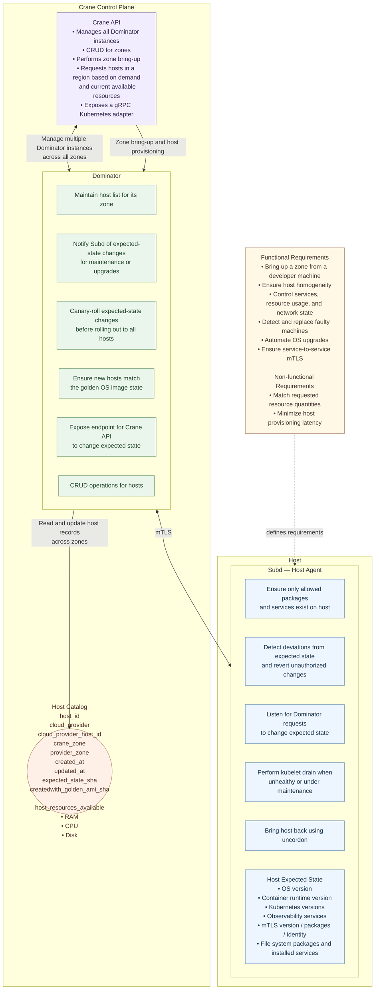

# Crane + Kubernetes: Merged Implementation Plan

**Status:** Proposed architecture and phased implementation plan
**Scope:** Kubernetes-first developer experience, capacity provisioning, zone placement, credit enforcement, fleet operations, and control-plane/data-plane observability
**Primary implementation language:** Go
**Infrastructure target for the first milestone:** AWS EC2
**Important boundary:** Application teams use Kubernetes APIs only. The Crane API team owns Crane services, provider integration, capacity management, operational tooling, and observability.
**Source documents:** Merged from `docs/Crane + Kubernetes: implementation pla.md` and `docs/observability.md`, restructured around the reference architecture in `docs/architecture-review.md`.

This plan merges two artifacts into one: the Kubernetes capacity-platform implementation plan, and the observability assessment + logging plan. All phases below assume the component structure and ownership shown in the reference architecture diagram (section 2). Observability is not an appendix; it is a horizontal requirement threaded through every phase.

-----------------------------------------------------------------------

## 1. Executive summary

Crane should be the infrastructure control plane underneath Kubernetes---not a second developer-facing platform. Developers deploy workloads using standard Kubernetes resources. Kubernetes scheduling and node autoscaling determine when additional worker-node capacity is needed. Crane's control plane (Crane API, Dominator, Host Catalog) authorizes, reserves, provisions, inventories, and retires the underlying hosts, while the host agent (Subd) enforces host-level state.

The merged plan retains the full Kubernetes integration surface:

-   Standard `Deployment`, `StatefulSet`, `Job`, `Pod`, `ResourceQuota`, affinity, and topology-spread APIs remain the default developer interface.
-   A platform-owned `CraneNodePool` custom resource describes eligible capacity profiles and zone policy.
-   The Kubernetes node autoscaler detects unschedulable Pods, evaluates eligible node groups, and requests capacity through the Crane autoscaler adapter.
-   Crane API is the single authoritative placement and policy decision-maker: it validates policy, reserves credits atomically, selects eligible zones, and reconciles desired capacity against actual instances.
-   Dominator executes provisioning and host lifecycle as a zone-scoped fleet controller; the Host Catalog provides the durable cross-zone inventory.
-   Observability is built in from the start: structured logging (stdlib `log/slog`), OTLP traces and metrics, health checks, audit events, and a clear control-plane/data-plane signal boundary.

**Do not fork Kubernetes or write a custom scheduler for the initial implementation.** Prefer the existing Cluster Autoscaler external gRPC cloud-provider interface. Keep the adapter boundary narrow so the platform can later support another autoscaler.

## 2. Reference architecture

The following diagram from `architecture-review.md` is the canonical component structure this plan implements. Every phase, ticket, and ownership decision in this document maps back to one of these components.



Three structural consequences of this diagram shape everything in this merged plan:

1.  **Crane API is the single placement and policy authority.** It does not provision hosts directly; it decides policy, selects zones, reserves capacity, and coordinates Dominator instances. This resolves the review's P0 question ("who owns the global capacity decision?") without building a fragile central orchestrator: global policy stays logically centralized in Crane API, while durable operations, idempotent controllers, and zone-level execution in Dominator make the system recoverable.
2.  **Dominator is zone-scoped, Subd is host-scoped.** Capacity decisions and fleet placement live in the control plane; host enforcement and repair live on the host. The data plane (Subd) is observable but does not stream telemetry to the control plane.
3.  **The Host Catalog is a durable inventory, not a cache.** It records lifecycle state, versioned desired/observed state, allocatable-minus-reserved resources, and durable operations so the fleet can be reconstructed from durable state rather than by querying every Subd.

## 3. Component responsibilities and ownership

### 3.1 Developer experience

A product team should be able to:

1.  Deploy a service through Kubernetes.
2.  Set Pod CPU and memory requests and limits.
3.  Set replicas and, when appropriate, use a HorizontalPodAutoscaler.
4.  Express placement needs using standard Kubernetes topology spread, affinity, taints/tolerations, and storage constraints.
5.  Select an approved capacity pool only when a workload requires a particular class of hardware.
6.  Inspect standard Kubernetes events, Pod status, and platform-provided capacity status without accessing Crane APIs or understanding Crane internals.

A developer should **not** need to:

-   Call Crane APIs directly.
-   Choose EC2 instance IDs or manually request hosts.
-   Translate internal Crane zone IDs into AWS Availability Zone names.
-   Implement host lifecycle, retry, or cloud reconciliation logic.
-   Understand credit reservation internals.

### 3.2 Team ownership

| Responsibility | Owner |
| --- | --- |
| Declare application CPU/memory requests | Application team |
| Decide where a Pod can be scheduled | Kubernetes scheduler |
| Decide when additional nodes are needed | Kubernetes node autoscaler |
| Choose target zone / required capacity / placement policy | Crane API (placement & policy) |
| Express approved pool and topology policy | Platform API / policy controller |
| Enforce team capacity credits | Crane API (authoritative reservation transaction) |
| Resolve Crane zones to AWS zones | Crane API / zone inventory |
| Provision, register, repair, terminate zone hosts | Dominator |
| Read and update cross-zone host inventory | Host Catalog |
| Enforce expected host state, drains, uncordon | Subd |
| Populate accurate node topology labels | Cloud integration / node bootstrap, validated by Crane |
| Reconcile desired and actual capacity | Crane API orchestrates; Dominator executes |
| Protects against workload replica spread violations | Kubernetes scheduler |
| Structured logging, metrics, audit events | All components, respecting the control/data plane boundary |

### 3.3 Crane API team ownership (observability included)

The Crane API team owns:

-   Crane API, persistence, credit accounting, capacity reconciliation, and cloud-provider implementation.
-   Canonical zone inventory and provider-zone resolution.
-   Node-pool capacity templates and validation.
-   Placement decision-making (zone eligibility, ranking, reservation).
-   The adapter that integrates the chosen Kubernetes node autoscaler with Crane.
-   The Host Catalog schema, lifecycle state machine, and durable operations.
-   Platform CRD schemas and controller implementation.
-   Operational dashboards, audit records, failure recovery, compatibility testing, alerting, and the observability baseline across crane-api, dominator, and subd.

## 4. Architecture decisions to make explicit

-   **Decision A — Kubernetes owns workload scaling.** Use the Kubernetes scheduler and an established node autoscaler. HPA adjusts replicas; the node autoscaler adjusts nodes. Crane receives node-capacity intents and never makes independent workload scheduling decisions.
-   **Decision B — Crane owns machine capacity.** Kubernetes does not create EC2 instances directly. The autoscaler adapter asks Crane to change node-group capacity.
-   **Decision C — Standard Kubernetes topology primitives.** Developers use standard topology labels and spread constraints. Do not invent a new workload-level zone API unless standard Kubernetes placement features cannot express a real requirement.
-   **Decision D — CRDs describe policy, not imperative work.** `CraneNodePool` declares desired policy; a controller validates and reconciles it. The autoscaler uses a provider interface for imperative scale up/down.
-   **Decision E — Credits are enforced at the Crane API boundary.** CRD validation improves feedback but is not the security or accounting boundary. Every capacity change is authorized and checked atomically by Crane API.
-   **Decision F — One authoritative placement decision-maker.** Global policy and capacity decisions are centralized logically in Crane API; Dominator only executes for its zone. The catalog distinguishes multiple independent zone controllers from replicas of one controller (the latter need leader election or partitioning).
-   **Decision G — Capacity is reserved capacity, not free resources.** Placement decisions use allocatable resources minus committed reservations, not raw observed utilization. The catalog's stored availability is a snapshot, not an atomic reservation.
-   **Decision H — Golden-image rollouts are versioned, not "latest".** Each rollout pins an immutable image ID/digest and a desired-state version. New hosts use the version assigned to their zone's rollout policy.
-   **Decision I — Capacity is a state progression.** Exposed stages run requested → provisioning → registering → ready → draining → terminated/failed, not a binary available/unavailable value.
-   **Decision J — Observability respects the trust boundary.** Control plane (crane-api, dominator) gets full structured logs, metrics, and audit trail. Data plane (subd) emits structured logs to local journald and reports outcome through its heartbeat; it keeps no open listener and streams no telemetry.

## 5. Kubernetes integration strategy

### 5.1 Prefer the Cluster Autoscaler external provider interface

For the initial implementation, evaluate the upstream Cluster Autoscaler external gRPC cloud-provider interface. Implement the contract for the exact Cluster Autoscaler release selected by the platform team. Do not copy an interface definition from a different release and assume wire or semantic compatibility.

The adapter should implement the operations needed to:

-   Discover and list node groups.
-   Report each group's target size and actual nodes.
-   Increase target size.
-   Decrease target size or delete selected nodes according to the interface contract.
-   Return a simulated/template node with correct CPU, memory, labels, taints, zone, and other scheduling-relevant metadata.
-   Report instance/node identity and lifecycle state.
-   Handle provider errors in a way the autoscaler can interpret safely.

Keep the adapter as a separately deployable service or tightly isolated package. It should be replaceable without redesigning Crane's capacity API.

**Version gate:** Before coding, pin the Kubernetes, Cluster Autoscaler, external provider protocol, and CRD API versions. Add a compatibility test against the exact upstream release. The external-provider API may have release-specific behavior; treat the selected upstream interface as a contract, not as generic pseudocode.

### 5.2 Why not start with a custom operator that watches Pods?

A Pod-watching operator would need to reproduce node scheduling simulation, Pod constraints, node affinity, taints, topology rules, storage constraints, and scale-down safety. Use the node autoscaler for **capacity decisions**, a custom Kubernetes controller for **configuration and policy**, and Crane API for **placement, host lifecycle, and credit enforcement**.

### 5.3 Alternative: Cluster API

Cluster API is valid if the longer-term goal includes creating and upgrading entire clusters. For the first milestone, choose either Cluster API or the external Cluster Autoscaler provider, not both.

## 6. API and data model

These are proposed models, not existing repository types. Adapt naming and storage to current repository conventions. The capacity models below live in Crane API; the Host Catalog record lives in the shared inventory.

### 6.1 Canonical zones

Crane should maintain canonical zone IDs scoped to a provider account and region. Do not assume a human-readable AWS zone suffix maps to the same physical zone across different AWS accounts.

``` go
type Zone struct {
    ID             string // e.g. "zone-a"
    Provider       string // e.g. "aws"
    AccountID      string
    Region         string // e.g. "us-west-2"
    ProviderZoneID string // e.g. "us-west-2a", account-scoped
    Enabled        bool
    Status         ZoneStatus
}

type ZoneStatus string

const (
    ZoneReady       ZoneStatus = "Ready"
    ZoneUnavailable ZoneStatus = "Unavailable"
    ZoneDraining    ZoneStatus = "Draining"
)
```

Recommended persistence constraints:

-   Unique `(provider, account_id, region, provider_zone_id)`.
-   Stable canonical `id` within Crane's namespace.
-   Store discovery time and last successful validation time.
-   Do not delete a zone record merely because a discovery call temporarily fails.
-   Mark a zone unavailable when it cannot accept new capacity; existing instances may still be running.
-   Treat zone status and instance-type availability as separate facts.

### 6.2 Host profiles / instance offerings

The availability of a host type varies by region and zone. Keep the generic profile separate from provider-specific offerings.

``` go
type HostProfile struct {
    Name            string // general-purpose, compute-optimized, memory-optimized
    VCPU            int
    MemoryMiB       int64
    Architecture    string
    GPUCount        int
    RequiredLabels  map[string]string
    Taints          []Taint
}

type ZoneOffering struct {
    ProfileName     string
    ZoneID          string
    ProviderType    string // e.g. an EC2 instance type
    Available       bool
    CapacityStatus  string
}
```

A pool template must use the resources and labels Kubernetes can actually observe. Account for allocatable resources rather than reporting all physical CPU and memory as schedulable application capacity.

### 6.3 Capacity pool model

``` go
type NodePool struct {
    ID              string
    ClusterID       string
    Name            string
    TeamID          string
    AllowedProfiles []string
    AllowedZoneIDs  []string
    MinNodes        int
    MaxNodes        int
    DesiredNodes    int
    Labels          map[string]string
    Taints          []Taint
    Enabled         bool
}
```

Use `TeamID` as a trusted, platform-resolved identity, not a field the requesting application can freely spoof. Make explicit whether a pool is team-dedicated or shared.

### 6.4 Capacity request model

The request model should distinguish the desired target from the operations used to reconcile it.

``` go
type CapacityRequest struct {
    ID             string
    IdempotencyKey string
    ClusterID      string
    NodePoolID     string
    DesiredNodes   int
    Reason         string
    CreatedAt      time.Time
}

type CapacityStatus struct {
    RequestID       string
    ObservedNodes   int
    TargetNodes     int
    Phase           string // Pending, Provisioning, Ready, Failed, Deleting
    Conditions      []Condition
    LastError       string
    UpdatedAt       time.Time
}
```

The adapter should usually set a node group's target size. Crane then reconciles actual instances toward that target. Avoid treating each autoscaler retry as a brand-new independent host-creation command, and aggregate pending demand (e.g. ten pending Pods → two hosts, not ten requests) before placing.

### 6.5 Credits and reservations

Prefer an explicit ledger over a single mutable `credits_remaining` number.

``` go
type TeamBudget struct {
    TeamID            string
    MaxVCPU            int
    MaxMemoryMiB       int64
    MaxNodes           int
    MaxHourlyCostUnits int64 // optional, if cost policy is needed
}

type CreditReservation struct {
    ID              string
    TeamID          string
    CapacityRequestID string
    NodePoolID      string
    VCPU            int
    MemoryMiB       int64
    NodeCount       int
    State           string // Reserved, Committed, Released, Failed
    CreatedAt       time.Time
}
```

Use a database transaction or equivalent concurrency-safe mechanism to verify the budget and create a reservation atomically. Enforce uniqueness for the request/idempotency key. Reconcile reservation state when provisioning succeeds, fails, is cancelled, or a node is removed.

Decide what a credit means before implementation:

-   **Capacity entitlement:** maximum simultaneous provisioned/reserved vCPU, memory, and/or node count.
-   **Consumption budget:** time-based cost such as instance-hours.
-   **Both:** capacity entitlement for admission control plus metering for chargeback.

Do not conflate these units.

### 6.6 Host Catalog inventory record

The Host Catalog is a durable control-plane inventory, not just a metadata table. A host record includes:

| Field | Purpose |
| --- | --- |
| `host_id` | Stable Crane-generated identity |
| `provider`, `provider_host_id` | Cloud resource identity |
| `crane_zone`, `provider_zone` | Logical placement and physical location |
| `lifecycle_state` | Requested, provisioning, registering, ready, draining, terminating, terminated, failed |
| `health_state` | Healthy, degraded, unhealthy, unknown |
| `desired_state_version` | Version of the configuration assigned to the host |
| `observed_state_version` | Version last successfully applied by Subd |
| `allocatable_resources` | Resources Kubernetes can schedule |
| `reserved_resources` | Resources already committed to workloads |
| `last_heartbeat_at` | Freshness of host observations |
| `operation_id` | Current provisioning, upgrade, or termination operation |

Existing `expectedstate_sha` / `createdwith_goldenos_sha` fields supplement, not replace, explicit version and lifecycle metadata. Cloud-provider observations, Dominator's desired operations, and Subd's host reports are reconciled into this inventory using idempotent operations and periodic repair. A missed heartbeat is a freshness signal, not proof a host is dead.

### 6.7 Capacity states

Expose capacity as a progression, not a binary value:

-   `requested` — the control plane accepted the demand.
-   `provisioning` — the cloud resource is being created.
-   `registering` — the host exists but isn't yet ready.
-   `ready` — the host has joined Kubernetes and passed readiness checks.
-   `draining` — the host is leaving service.
-   `terminated` or `failed` — completed or requires recovery.

A VM existing in the cloud does not mean Kubernetes can schedule onto it.

## 7. Proposed CRDs

Start with one primary CRD: `CraneNodePool`. Add `CraneTeamQuota` only if the organization needs Kubernetes-visible quota declarations or review workflows.

### 7.1 `CraneNodePool`

``` yaml
apiVersion: platform.crane.io/v1alpha1
kind: CraneNodePool
metadata:
  name: payments-general
  namespace: platform-system
spec:
  clusterRef: production-us-west
  ownerTeam: payments
  profiles:
    - general-purpose
    - compute-optimized
  placement:
    region: us-west-2
    zones:
      - zone-a
      - zone-b
      - zone-c
    strategy: balanced
  capacity:
    minNodes: 0
    maxNodes: 20
  scheduling:
    labels:
      platform.crane.io/pool: payments-general
    taints: []
  credits:
    budgetRef: payments-production
status:
  observedGeneration: 1
  conditions:
    - type: Valid
      status: "True"
      reason: PolicyValidated
```

Design notes:

-   Put these objects in a platform-controlled namespace or a cluster-scoped API depending on the authorization model.
-   Application teams must not be able to grant themselves new profiles, zones, quotas, or larger limits.
-   `status` is controller-written and reports observed conditions; it is not user input.
-   Use a structural OpenAPI schema, defaults, CEL validation where appropriate, and conversion webhooks only if versioning requires them.
-   Avoid accepting arbitrary provider-specific instance IDs in this CRD.

### 7.2 Optional `CraneTeamQuota`

``` yaml
apiVersion: platform.crane.io/v1alpha1
kind: CraneTeamQuota
metadata:
  name: payments-production
  namespace: platform-system
spec:
  team: payments
  maxNodes: 20
  maxVCPU: 64
  maxMemoryGiB: 256
  allowedProfiles:
    - general-purpose
    - compute-optimized
  allowedZones:
    - zone-a
    - zone-b
    - zone-c
```

Do not permit application teams to create or modify their own authoritative quota object. Use RBAC and admission policy to restrict write access to platform operators. Crane API must independently enforce the same budget.

### 7.3 Avoid a service-name-only authorization model

Kubernetes service names are not globally unique and can be spoofed across namespaces if authorization is poorly designed. Resolve identity from trusted metadata: a platform-managed team registry, namespace ownership, workload identity, or an approved pool binding. A workload should not gain a larger infrastructure budget merely by setting `metadata.name: high-budget-service`.

## 8. Zone resolution and placement

### 8.1 Source of truth

Crane API owns the mapping from canonical zone IDs to provider-specific zones. The Kubernetes integration publishes each node group's real zone, region, and capabilities.

Use standard labels on actual Nodes:

-   `topology.kubernetes.io/region`
-   `topology.kubernetes.io/zone`
-   `kubernetes.io/hostname`
-   A platform label such as `platform.crane.io/node-pool`

Do not use the internal canonical zone ID as a substitute for the standard zone label.

### 8.2 Node-pool and zone-group relationship

A logical pool may permit multiple zones, but the autoscaler may require distinct underlying node groups per zone or capacity class.

``` text
CraneNodePool: general-purpose-ha
  |
  +-- autoscaler group: general-purpose-zone-a
  |       +-- Crane zone-a -> provider zone us-west-2a
  |
  +-- autoscaler group: general-purpose-zone-b
  |       +-- Crane zone-b -> provider zone us-west-2b
  |
  +-- autoscaler group: general-purpose-zone-c
          +-- Crane zone-c -> provider zone us-west-2c
```

Each underlying group must have a correct node template. A group provisionable only in zone A must not advertise a template in zone B.

### 8.3 Placement strategies

Support a small, explicit set of policies:

-   `Any`: provision in any permitted, eligible zone.
-   `Balanced`: distribute capacity across eligible zones where the autoscaler/provider integration supports this safely.
-   `Pinned`: use a single permitted zone, only when a real workload or infrastructure dependency requires it.

Kubernetes Pod topology spread is the mechanism for replica distribution; infrastructure balancing is a separate policy. Do not promise perfect balance if the autoscaler cannot guarantee it.

### 8.4 Pod placement

Use standard Kubernetes primitives: `topologySpreadConstraints`, `podAntiAffinity`, `nodeAffinity`/`nodeSelector`, taints and tolerations, and storage topology/CSI behavior. Strict topology rules can leave Pods pending if a zone is unavailable; document that tradeoff for developers.

### 8.5 Zone failure and drain behavior

When a zone becomes unavailable:

1.  Mark it in Crane's inventory as unavailable for new provisioning.
2.  Stop offering it as a scale-up destination.
3.  Do not automatically terminate healthy existing nodes just because discovery temporarily failed.
4.  Surface the condition to the platform and autoscaler.
5.  Allow Kubernetes to reschedule workloads only where their placement constraints permit.
6.  Keep replacement capacity within quota and eligible zones.
7.  If a pool can no longer satisfy its policy, expose an explicit degraded condition rather than silently weakening a strict placement rule.

## 9. Scale-up end-to-end flow

1.  A team applies or updates a standard Kubernetes workload.
2.  The scheduler tries to place Pods using resource requests, affinity, taints, topology spread, storage constraints, and current node availability.
3.  Pods that cannot be scheduled remain pending with scheduler events.
4.  The node autoscaler simulates eligible node-group templates to determine which group could accommodate the Pods, **aggregating** pending demand so a burst does not produce one request per Pod (bin packing, per-host allocatable resources, workload constraints, configurable buffer).
5.  It selects a compatible group according to its strategy and configured limits.
6.  The adapter receives the desired node-group size.
7.  Crane API validates:
    -   Cluster and pool are registered and enabled.
    -   The group/profile/zone combination is valid.
    -   The team has permission to use the pool.
    -   The target remains within pool min/max and team budgets.
    -   The selected instance type is available in the zone.
    -   Capacity and quota reservations are safe under concurrent requests.
8.  Crane API **atomically reserves capacity**, records the new desired target, and creates a durable provisioning operation with an idempotency key.
9.  Crane API performs zone selection (filter zones violating constraints or capacity/limits, rank by headroom/provisioning latency/cost/fault-domain distribution, reserve required capacity) and dispatches the operation to the owning Dominator.
10. Dominator provisions, registers, and bootstraps the instances through the cloud-provider abstraction and tracks in-flight operations.
11. Hosts reconcile their expected state (Subd enrolls, applies versioned expected state, passes health checks) and register as Kubernetes Nodes with correct topology and pool labels.
12. The autoscaler observes the new nodes; Kubernetes schedules the Pods.
13. Crane records status, reconciles reservations against actual inventory, and emits audit events, metrics, and Kubernetes-visible conditions.

A scale-up request is asynchronous: "request accepted" is a valid API response; host readiness comes later. Define clear timeouts, retry behavior, and observable states.

## 10. Scale-down end-to-end flow

Scale-down is more conservative than scale-up:

1.  Workloads scale down or move, leaving nodes underutilized (assessed over sustained demand with cooldowns/hysteresis).
2.  The autoscaler determines whether a node can be removed without violating Pod disruption budgets, local storage constraints, or minimum zone capacity.
3.  The autoscaler requests a target-size reduction or deletion through the adapter.
4.  Crane validates that the node belongs to a managed group and that deletion is allowed.
5.  Dominator marks hosts unschedulable and drains them through Kubernetes; Subd executes the drain.
6.  Confirm eviction and workload rescheduling before taking further action. If a drain cannot complete, cancel or defer termination rather than forcibly removing the host.
7.  Terminate the cloud instances and update the Host Catalog.
8.  Reconcile reservations/credit accounting after the instance is actually released.

Do not return credits merely because a target-size number decreased. Reconcile against actual lifecycle state so a failed or delayed termination does not create a budget-accounting gap.

## 11. Failure handling and consistency

The system has multiple asynchronous controllers, so design for retries and partial failures rather than exactly-once execution.

-   **Idempotency:** repeated increase/decrease operations converge on the same target state; idempotency keys on all provisioning operations.
-   **Optimistic concurrency or transactions:** concurrent requests cannot exceed a team's budget or overallocate a zone.
-   **Durable desired state:** persist the target before attempting external cloud side effects; persisted operations survive controller restarts.
-   **Reconciliation:** periodically compare desired state, Crane's database, the Host Catalog, cloud instances, and Kubernetes Nodes.
-   **Partial provisioning:** handle an instance launch succeeding while response delivery fails.
-   **Stale inventory:** distinguish temporary cloud API errors from authoritative deletion.
-   **Quota exhaustion:** return a clear capacity-denied result and surface a useful Kubernetes event/condition where possible.
-   **Zone exhaustion:** try another eligible group only if policy and scheduling constraints allow it.
-   **Instance-type unavailability:** avoid an infinite retry loop; expose a degraded state and retry with backoff.
-   **Scale-down safety:** never terminate instances outside the managed group or protected by platform policy.
-   **Credit reconciliation:** periodically detect orphaned reservations, leaked allocations, and hosts without corresponding reservations.
-   **Heartbeat resilience:** do not interpret a missed heartbeat as proof a host is dead during a network partition.
-   **Recovery, not synchronous rebuild:** Dominator reconstructs its zone view from durable state plus cloud/provider and host reports, not by querying every Subd.
-   **API security:** authenticate the adapter, authorize cluster/pool operations, bound retries/timeouts with backoff and circuit breakers, and audit every target-size change.

Do not let the CRD controller and adapter independently maintain separate authoritative quota counters. There must be one authoritative reservation transaction path in Crane API.

## 12. Security and multi-tenancy

-   Developers use Kubernetes RBAC and the organization's standard deployment workflow.
-   Platform administrators own `CraneNodePool` and authoritative quota writes.
-   The adapter authenticates to Crane with a dedicated workload identity or service credential.
-   Crane authorizes the adapter's cluster and pool scope; it must not trust a client-supplied `teamID` without resolving it.
-   Application namespaces map to trusted team identities through a platform-owned registry or admission-controlled metadata.
-   Restrict who can set privileged node selectors, tolerations, host namespaces, or pool labels.
-   mTLS alone does not establish authorization. Every connection needs both authenticated identity and scoped authorization:

| Connection | Required control |
| --- | --- |
| Crane API → Dominator | Authenticated service identity and authorization scoped to permitted zones and operations |
| Dominator → Subd | Authenticated, authorized host-management requests |
| Subd → control plane | Authenticated reporting; host identity bound to its registered provider instance |
| Kubernetes integration → Crane API | Authenticated caller and authorization for capacity operations |
| Crane API → Host Catalog | Restricted database access and audited state changes |

-   Use cloud-provider instance identity or another trusted bootstrap mechanism when enrolling hosts; do not treat a reusable join token as proof of host identity.
-   Keep cloud credentials in the Crane execution environment, not in application namespaces or developer manifests.
-   Audit capacity changes, image rollouts, host drains, terminations, quota denials, zone selections, and instance launches.
-   Apply API rate limits and maximum request sizes.
-   Do not wire `internal/hostcatalog/http` handlers (currently unauthenticated, dead code) without mTLS auth and audit middleware first.

## 13. Golden-image and expected-state rollout

"Latest" is an ambiguous target during a rollout. Pin every rollout to an immutable image ID/digest and a desired-state version:

-   Dominator tracks rollout progress per zone and canary-rolls expected-state changes before full rollout.
-   New hosts are created with the version their zone's rollout policy assigns, not whatever image is currently latest.
-   Subd enforces the host's assigned `desired_state_version` and reports `observed_state_version`.
-   Subd reconciles OS, runtime, Kubernetes, observability, and security configuration against the expected state.
-   Subd does not independently uncordon a recovered host; it returns to service only when the maintenance operation completes and the host is authorized.
-   Define precisely whether package enforcement is an allowlist, package-state reconciliation, immutable-image enforcement, or a combination, and avoid removing packages required for emergency recovery or provider agents.

## 14. Observability

Merged from `docs/observability.md` into this plan as a first-class workstream, mapped onto the reference architecture's control-plane/data-plane split.

### 14.1 Principles

-   **Control plane (`crane-api`, `dominator`)** — full observability: structured logs, OTLP traces and metrics, and an audit trail. The Host Catalog is the natural instrumentation chokepoint for fleet state mutations.
-   **Data plane (`subd`)** — observable but bounded. subd runs root on tenant-/attacker-influenced hosts, so it:
    1.  emits structured logs locally to journald (it is a systemd unit on the host);
    2.  reports **outcome** through the heartbeat it already sends to Dominator so the control plane can produce fleet metrics;
    3.  keeps no open listener. A thin agent is a smaller attack surface.

### 14.2 Current-state baseline (findings that drive the work)

The repository has essentially no production-grade observability today:

-   Unstructured stdlib `log` everywhere; zero observability dependencies in `go.mod`; no leveling, JSON, key-value fields, or request/host/trace IDs.
-   Secrets reach logs: DSN with DB password (`cmd/crane-api/main.go:97-102`), raw heartbeat bodies (`internal/dominator/server.go:127,134`), RDS connection info (`internal/execute/executor.go:114,152`).
-   Invalid log calls that fail `go vet`: `%w` wrappers (`internal/subd/runner.go:31,36`), printf-style `log.Fatal` (`cmd/dominator/main.go:34`).
-   Errors are logged-and-swallowed throughout control loops (`internal/badhost/detector.go:50-53`, `internal/subd/services_collector.go:114`), so failures are invisible.
-   `log.Fatal` in library/execution paths kills the process on recoverable errors (`internal/execute/executor.go:94,111,143`, `internal/dominator/server.go:56-59`).
-   No audit trail: the persisted `actions` table records outcomes but not rationale, driving problems, or actor identity.
-   No metrics, no `/metrics` endpoint, no tracing, no context propagation. The pipeline is correlated only by `host_id` in Postgres.
-   Health checks are shallow: `/health` returns a fixed 200 (`cmd/crane-api/main.go:162-165`); no liveness/readiness split; no `HEALTHCHECK` in Dockerfiles.
-   No alerting signal path, no audit middleware, no version/commit injection, no log-level/log-format/metrics-port config, and CI only runs `go build` (`.github/workflows/go.yml:24-25`).

### 14.3 Structured logging (Phase 1 of this workstream)

All binaries migrate to stdlib `log/slog` (Go 1.25) with **no behavior change and no new dependencies**.

1.  **Shared logger setup (per binary).** Each `cmd/*/main.go` builds a `*slog.Logger` from env vars:
    -   `LOG_LEVEL` (debug/info/warn/error, default `info`)
    -   `LOG_FORMAT` (json/text, default `text` local, `json` in containers)
    -   Always add a `service` field (`crane-api`, `dominator`, `subd`, `crane-autoscaler-adapter`, `crane-controller`) and `version`/`commit` once build metadata is injected.
2.  **Thread the logger through constructors.** Pass `*slog.Logger` into constructed types (`BadHostDetector`, `ActivityManager`, `Worker`, `DefaultExecutor`, `PostgresActionStore`, `PostgresHostStore`, `HostCatalogService`, `PolicyResolver`, `Dominator` server, subd Runner/Client/collectors) instead of package-level `log`. Use a temporary std-log→slog bridge during migration if needed.
3.  **Replace hot-path log calls with typed fields.** Convert `log.Printf("[X] ...")` lines to `logger.Info/Debug/Warn/Error` with structured attributes such as `host_id`, `action_type`, `check`, `problem_type`, `zone`, `node_pool`, `request_id`. Use `Warn`/`Error` (never `Info`) for failures.
4.  **Fix correctness and safety issues:** redact DSN/raw-body/connection-info logging; fix invalid format verbs; replace `log.Fatal` in library code with returned errors (only `main` decides to exit).
5.  **Audit-grade events (control plane).** Emit JSON structured events on every remediation decision (with `host_id`, `action_type`, and the problems that drove it), every catalog state transition (`host_id`, `from_state`, `to_state`), and every capacity/credit decision.
6.  **Verify.** Run `gofmt -l`, `go vet ./...`, `go test ./...` after migration, and add all three to CI.

### 14.4 Metrics

Emit OTLP traces and metrics via gRPC exporters (configurable via `OTEL_EXPORTER_OTLP_ENDPOINT`); expose a `/metrics` endpoint (Prometheus) where appropriate as a convenience surface on `crane-api`, `dominator`, and optionally the adapter. Two sets of signals:

**Fleet and runtime health (from the observability assessment):**

-   Hosts scanned, problems by check/severity.
-   Actions by type and outcome; queue depth; heartbeat age.
-   Provider/DB latency; reconciliation errors by controller; audit event rate.

**Capacity platform (from the Kubernetes plan):**

-   `crane_capacity_requests_total{result,reason}`
-   `crane_capacity_request_duration_seconds` (measure request-acceptance latency separately from host-readiness latency)
-   `crane_nodes_desired` / `crane_nodes_actual`
-   `crane_credit_reserved_vcpu` / `crane_credit_reserved_memory_bytes`
-   `crane_credit_denials_total{reason}`
-   `crane_zone_capacity{zone,profile,state}`
-   `crane_instance_provision_failures_total{provider,reason}`
-   `crane_reconciliation_errors_total{controller}`
-   `crane_duplicate_provisioning_requests_total`, `crane_unused_capacity` (autoscaling efficiency)

Map these to service-level objectives (from the architecture review): scheduling failures due to insufficient allocatable resources; time from accepted request to Kubernetes-ready host; time from confirmed failure to restored capacity; failed/incomplete drains; time in desired/observed mismatch; scale oscillation; unauthorized control operations; failed rollout rate.

Avoid high-cardinality labels such as Pod UID, request UUID, or arbitrary service name on every metric. Put per-request identity in structured logs and traces.

### 14.5 Tracing

Introduce context propagation across the problem → decision → action pipeline (currently correlated only by `host_id`). Carry `request_id`/trace context through capacity requests, provisioning operations, and remediation decisions. Emit distributed traces via OTLP. Thread trace context (TraceContext/Baggage) across all control-plane boundaries and include `request_id` in logs for correlation.

### 14.6 Health checks and deployment hygiene

-   Split **liveness** (process up) from **readiness** (DB/provider reachable, controllers initialized) on `crane-api` and `dominator`.
-   Add `HEALTHCHECK` to `Dockerfile.crane-api`, `Dockerfile.dominator`, and any new binaries.
-   Add `HEALTHCHECK`, restart policies, resource limits, and log config to `docker-compose.yml`.
-   Inject `version`/`commit` via `-ldflags` in Dockerfiles and CI so a running binary can be correlated to a commit.

### 14.7 Dashboards and alerting

**Dashboards:**

1.  Pending Pods by reason and duration.
2.  Desired vs. actual nodes by pool and zone.
3.  Fleet health: hosts by lifecycle/health state, heartbeat age, queue depth.
4.  Provisioning latency (acceptance vs. readiness) and failure rate.
5.  Team budgets: reserved vs. allocated vs. remaining.
6.  Zone/profile availability.
7.  Reconciliation drift and orphaned reservations.
8.  Scale-up requests denied by policy or quota.

**Alerting:** capacity drift, quota denials, provisioning failures, stale reservations, unhealthy heartbeat age, failed/incomplete drains. Add these only after the signal path exists; today, logged-and-dropped errors mean operators have no way to learn something is failing.

### 14.8 Kubernetes-facing diagnostics

Developers should diagnose pending workloads from Kubernetes:

-   Pod scheduler events explain why the Pod is pending.
-   Node-pool conditions explain whether eligible capacity is available.
-   A quota-denial event or platform status explains when scale-up was rejected.
-   Standard Node labels reveal region and zone.
-   Documentation explains the difference between an unschedulable Pod, a quota denial, and a cloud provisioning failure.

## 15. Testing strategy

### Unit tests

-   Canonical zone resolution and provider/account scoping.
-   Profile/zone availability validation.
-   Node template generation: CPU, memory, labels, taints, topology.
-   Credit calculations and transactional reservation rules.
-   Idempotent target-size updates.
-   Pool min/max and team quota enforcement.
-   Failure transitions, drain handling, and reservation release.
-   Authorization and team identity resolution.
-   Placement: zone filtering, ranking, and reservation safety.
-   Host Catalog lifecycle state transitions.
-   Redaction and structured-field correctness for logging.

### Contract tests

-   Adapter against the exact upstream autoscaler external-provider protocol.
-   Crane API compatibility and error mapping.
-   Cloud provider abstraction using a fake provider or LocalStack where supported.
-   CRD schema validation, defaulting, RBAC, and status conditions.
-   Bootstrap contract ensuring nodes receive the correct standard topology labels.
-   Dominator ↔ subd mTLS and authorization contract.

### Integration tests

1.  Create a pool in a test cluster.
2.  Deploy a workload that fits existing capacity; verify no scale-up.
3.  Deploy enough replicas to make Pods unschedulable; verify the autoscaler requests more capacity **as one aggregated request**.
4.  Verify Crane reserves credits once and provisions the expected profile in an allowed zone through Dominator.
5.  Verify Nodes join with correct labels, Subd reports readiness, and Pods become schedulable.
6.  Exhaust a team's quota; verify scale-up is denied without leaking reservations.
7.  Make one zone unavailable; verify new capacity is directed only to eligible zones.
8.  Scale the workload down; verify safe node removal, drain completion, and credit reconciliation.
9.  Inject cloud/API failures and retries; verify idempotent convergence.
10. Restart controllers (adapter, crane-api, dominator) mid-operation; verify recovery from durable desired state.
11. Verify audit events and metrics appear for a full scale-up/scale-down cycle.

### End-to-end acceptance criteria

-   Application teams never need Crane credentials or direct Crane API access.
-   A standard Kubernetes workload can trigger capacity provisioning automatically.
-   The autoscaler sees correct node templates before provisioning.
-   The resulting nodes have correct provider zone, region, and pool labels.
-   Zone-spread constraints behave predictably.
-   Concurrent requests cannot exceed team budgets.
-   Repeated requests do not double-provision or double-reserve.
-   Scale-down, failed launches, and controller restarts converge without credit leaks.
-   Operators can trace a workload's pending state through autoscaler decision, Crane request, zone selection, Dominator provisioning, Subd enrollment, and node registration.
-   Logs are structured and safe; `gofmt -l`, `go vet ./...`, and `go test ./...` pass in CI.

## 16. Phased implementation plan

The phases merge the Kubernetes plan's phases (0–7), the architecture review's recommended order (control-plane data model → one zone end to end → global placement → scale-up → scale-down/repair → harden fleet ops), and the observability plan's phases. Observability work is explicit work in the early phases and gets hardened in phase 9.

### Phase 0 — Architecture and compatibility spike

**Deliverables:**
-   Select the autoscaler, exact upstream Cluster Autoscaler version, and CRD API versions.
-   Verify the external gRPC provider contract and node-group semantics.
-   Decide whether node groups are per-zone, per-profile, or a supported combination.
-   Define team identity source and whether pools are dedicated or shared.
-   Define credit semantics: capacity entitlement, cost budget, or both.
-   Document scale-down ownership and drain semantics.
-   Confirm how node bootstrap receives cloud zone metadata and labels.
-   Decide the placement authority model: Crane API owns policy; Dominator owns zone execution.
-   Pin observability defaults: `slog`-based structured logging, log level/format config, and OTLP (traces/metrics) as the mandated telemetry backend.

**Exit criteria:**
-   A design decision record answers each item above.
-   A minimal adapter prototype can report one static node group and a valid node template to the chosen autoscaler.

### Phase 1 — Control-plane data model and structured-logging foundation

**Deliverables:**
-   Canonical `Zone` and `HostProfile` models; provider discovery for region, zones, and instance-type offerings; persistence and uniqueness constraints.
-   Host Catalog durable schema: host lifecycle states, health state, desired/observed state versions, allocatable vs. reserved resources, durable operation records.
-   Shared `slog` logger setup in each `cmd/*/main.go` (`LOG_LEVEL`, `LOG_FORMAT`, `service` field).
-   Thread the logger through constructors; replace hot-path `log` calls with typed fields.
-   Fix logging safety and correctness: redact DSN/raw-body/RDS info, fix invalid format verbs, replace library `log.Fatal` with returned errors.
-   Initialize OTLP telemetry (traces/metrics) in each control-plane binary via `internal/telemetry`; propagate trace context; Run `gofmt -l`, `go vet ./...`, `go test ./...`; add all three to CI.

**Exit criteria:**
-   Host creation, failure, and termination are representable accurately, including after controller restarts.
-   All control-plane binaries compile with structured, correlated, redaction-safe logging and OTLP telemetry initialized (with no-op fallback when OTEL_EXPORTER_OTLP_ENDPOINT unset).

### Phase 2 — One zone end to end

**Deliverables:**
-   Durable capacity request/status records with idempotency keys.
-   Provider-backed instance create/delete operations; desired-vs-actual reconciler in this zone's Dominator.
-   Node-pool persistence and validation; explicit lifecycle states and retry/backoff behavior.
-   Dominator copies host lifecycle operations to the Host Catalog; Subd enrolls and reports readiness.
-   Audit events on catalog state transitions and remediation decisions.
-   Fake-provider tests and LocalStack integration tests where practical.

**Exit criteria:**
-   Crane API accepts a capacity request, Dominator provisions an instance, Subd enrolls it, and Kubernetes sees a ready node.
-   A request can be retried safely; a failed provisioning operation recovers without duplicate hosts or orphaned resources.
-   The operator can observe the full flow in structured logs and audit events.

### Phase 3 — Credits and authorization

**Deliverables:**
-   Team budget model and reservation ledger.
-   Transactional reservation API with idempotency and concurrent-request tests.
-   Trusted team/cluster/pool identity mapping.
-   Quota-denial reasons and audit records.
-   Periodic reservation/instance reconciliation.
-   Environment-scoped authorization for the Crane API → Dominator and Dominator → Subd boundaries (mTLS plus authorization).

**Exit criteria:**
-   Concurrent requests cannot exceed the configured budget, and every provisioned or pending instance is accounted for.

### Phase 4 — Global placement

**Deliverables:**
-   Zone eligibility filtering (hard constraints, capacity/instance-type fit, availability, configured limits).
-   Zone ranking policy: headroom, provisioning latency, cost, fault-domain distribution.
-   Capacity reservation at placement time (allocatable minus reserved).
-   Zone-scoped Dominator ownership with explicit replication/leader-election rules.
-   Audit of zone selections and reservations.

**Exit criteria:**
-   Concurrent requests cannot overallocate a zone; workloads with zone constraints are placed only into eligible zones.

### Phase 5 — Autoscaler adapter and scale-up

**Deliverables:**
-   External provider adapter for the selected Cluster Autoscaler release.
-   Accurate node-group discovery, target-size, node inventory, and template responses.
-   Pending-demand aggregation and request deduplication before calling Crane.
-   Increase/decrease operations backed by Crane's capacity API and placement logic.
-   Error mapping for quota denial, unsupported profile, unavailable zone, and provider failure.
-   Protocol contract tests and a small end-to-end test cluster.

**Exit criteria:**
-   An unschedulable test Pod causes a node-capacity request through the autoscaler, adapter, and Crane, and becomes schedulable once the node joins — without application teams touching Crane directly.

### Phase 6 — `CraneNodePool` CRD and policy controller

**Deliverables:**
-   Versioned CRD schema, generated manifests, RBAC, and admission rules preventing privilege escalation.
-   Controller that validates pool references, zones, profiles, min/max, and authorization.
-   Status conditions and clear validation errors; controller-to-Crane reconciliation path.
-   Generated API docs and example manifests.

**Exit criteria:**
-   A platform operator can declare a pool through Kubernetes configuration, and the validated pool is reflected in Crane and exposed to the autoscaler without manual database edits.

### Phase 7 — Scale-down, repair, and zone-aware operations

**Deliverables:**
-   Safe draining (respecting PDBs, local storage, min-zone capacity), capacity protection, and credit release after actual termination.
-   Failure detection and replacement workflows; orphan reconciliation.
-   Per-zone node-group representation, accurate templates, and standard topology labels.
-   Multi-zone test workloads using topology spread; zone-outage and profile-unavailable handling.
-   Operator dashboards and alerts for capacity drift and scale failures.

**Exit criteria:**
-   Workloads spread across eligible zones as specified; Crane does not launch into disallowed or unavailable zones; Crane removes excess capacity without disrupting protected workloads and recovers from failed hosts.

### Phase 8 — Golden-image rollouts and fleet hardening

**Deliverables:**
-   Versioned golden-image/expected-state rollout: dominator tracks rollout progress, canary-rolls change, pins immutable image/digest per zone policy; Subd enforces assigned `desired_state_version`.
-   Fault injection, load tests, restart-recovery tests.
-   subd journald logging and heartbeat enrichment (convergence outcome); no streaming telemetry, no open listener.

**Exit criteria:**
-   Provisioning, maintenance, and upgrades remain safe under retries, partial outages, and controller restarts; rollout progress and host convergence are observable from the control plane.

### Phase 9 — Observability hardening and production readiness

**Deliverables:**
-   `/metrics` (Prometheus/`expvar`) on crane-api, dominator, and the adapter; SLO-aligned dashboards and alerts.
-   Liveness/readiness split and `HEALTHCHECK` in Dockerfiles; `docker-compose.yml` healthchecks, restart policies, resource limits.
-   `-ldflags` version/commit injection wired through CI.
-   Audit middleware for API calls; mTLS auth before wiring `internal/hostcatalog/http` handlers.
-   Request/trace correlation across the capacity pipeline.
-   Security review of adapter identity and authorization; runbooks for unavailable zones and stuck scale operations; pilot with one non-critical workload.

**Exit criteria:**
-   Every binary is observable (structured logs, health, metrics, version), the fleet control loop is auditable end to end, and runbooks cover the primary failure modes.

### Phase 10 — Developer self-service rollout

**Deliverables:**
-   Standard workload examples and golden paths.
-   Documentation for CPU/memory requests, HPA, topology spread, pool selection, taints, and quota behavior.
-   Kubernetes-only troubleshooting workflow.
-   Example GitOps repository with approved pool and workload manifests.
-   Operational runbooks and escalation paths; gradual rollout to pilot teams.

**Exit criteria:**
-   Pilot developers deploy and scale workloads using Kubernetes alone, while the Crane API team can trace and manage all underlying capacity operations and observe the fleet without reading raw application manifests.

## 17. Suggested repository layout

Adapt to the existing repository rather than mechanically renaming current packages. Target organization:

``` text
cmd/
  crane-api/
  crane-dominator/
  crane-subd/
  crane-autoscaler-adapter/
  crane-controller/             # if the Kubernetes controller is a separate binary

api/
  crane/v1/                     # internal/public Crane API types
  platform/v1alpha1/            # CRD API types

config/
  crd/
  rbac/
  samples/

internal/
  capacity/
    service.go
    request.go
    reconciler.go
    status.go
    placement.go               # zone eligibility, ranking, reservation
  credit/
    ledger.go
    reservation.go
    policy.go
  hostcatalog/
    model.go                   # lifecycle state machine, versions
    store.go
    reconcile.go
  dominator/
  subd/
  nodepool/
    model.go
    service.go
    validation.go
  zone/
    model.go
    discovery.go
    resolver.go
  hostprofile/
    model.go
    catalog.go
  autoscaler/
    adapter.go
    nodegroup.go
    template.go
    errors.go
  provider/
    provider.go
    awscompute/
  persistence/
  audit/
  observability/
    logging.go
    metrics.go
    health.go

controllers/
  cranenodepool_controller.go
  cranteamquota_controller.go    # optional

deploy/
  helm/
  kustomize/
  examples/

docs/
  architecture/
  decisions/
  runbooks/
```

Keep the cloud provider interface behind a narrow abstraction. Do not make core capacity, credit, or lifecycle logic depend directly on AWS SDK types.

## 18. Initial implementation tickets

### Epic A — Control-plane data model and logging foundation (Phase 1)

-   [ ] Add canonical zone and host-profile models with provider discovery.
-   [ ] Add Host Catalog schema: lifecycle/health states, state versions, allocatable vs. reserved, durable operations.
-   [ ] Add node-pool persistence and validation; capacity request/status persistence.
-   [ ] Define API error taxonomy.
-   [ ] Add shared `slog` setup and thread the logger through all constructors.
-   [ ] Convert hot-path logging to typed fields; fix redaction, format verbs, and library `log.Fatal`.
-   [ ] Add audit events for catalog state transitions; run `gofmt`/`go vet`/`go test` in CI.

### Epic B — Reconciliation and provider operations (Phases 2 and 7)

-   [ ] Implement desired-vs-actual node reconciliation in Dominator.
-   [ ] Make provisioning and termination idempotent with idempotency keys.
-   [ ] Handle partially successful provider operations.
-   [ ] Add retry/backoff and reconciliation metrics.
-   [ ] Add drain, PDB-safe scale-down, and min-zone capacity protection.
-   [ ] Add orphaned-reservation and leaked-host reconciliation.

### Epic C — Credits and policy (Phases 3 and 4)

-   [ ] Define credit units and accounting rules.
-   [ ] Implement transactional reservations.
-   [ ] Enforce pool min/max and team quotas.
-   [ ] Add zone eligibility, ranking, and placement-time reservation.
-   [ ] Add trusted team identity resolution.
-   [ ] Add audit events and quota-denial diagnostics.

### Epic D — Autoscaler integration (Phase 5)

-   [ ] Pin the supported Cluster Autoscaler version and external provider protocol.
-   [ ] Implement node-group discovery and node templates.
-   [ ] Implement pending-demand aggregation and request deduplication.
-   [ ] Implement target-size increase/decrease operations.
-   [ ] Map Crane errors to autoscaler-compatible errors.
-   [ ] Test scale-up, scale-down, retries, and restarts.

### Epic E — Kubernetes policy (Phase 6)

-   [ ] Define `CraneNodePool` CRD (and optional `CraneTeamQuota`).
-   [ ] Generate schema, RBAC, and installation manifests.
-   [ ] Implement validation and status conditions.
-   [ ] Reconcile CRD state into Crane's validated pool catalog.
-   [ ] Add sample multi-zone pool and workload manifests.
-   [ ] Verify developers cannot modify authoritative quotas or provider mappings.

### Epic F — Observability and production readiness (Phases 8 and 9)

-   [ ] Add `/metrics` and SLO-aligned dashboards: capacity, fleet health, budgets, zone availability, drift.
-   [ ] Add alerts: capacity drift, quota denials, provisioning failures, stale reservations, heartbeat age, failed drains.
-   [ ] Add liveness/readiness split, `HEALTHCHECK`, docker-compose healthchecks, and `-ldflags` version injection.
-   [ ] Add request/trace correlation across the capacity pipeline.
-   [ ] subd journald logging + heartbeat outcome enrichment.
-   [ ] Perform security review of adapter identity/authorization; add audit middleware; secure `hostcatalog` HTTP.
-   [ ] Run failure-injection and load tests; add runbooks; pilot with one non-critical workload.

## 19. Important non-goals for the first release

-   Forking Kubernetes or Cluster Autoscaler; implementing a custom Pod scheduler.
-   Exposing Crane APIs or cloud credentials to application teams.
-   Supporting every cloud provider and every instance family immediately.
-   Building a universal cost optimizer before reliable capacity reconciliation exists.
-   Automatically relaxing strict topology rules during zone failures.
-   Implementing both Cluster API and a separate autoscaler provider integration in the first milestone.
-   Treating the CRD controller as the authoritative credit ledger.
-   Assuming one logical multi-zone pool maps to one homogeneous autoscaler node group.
-   Streaming subd telemetry to the control plane or opening listeners on subd.
-   Introducing third-party logging frameworks when stdlib `slog` covers the baseline.

## 20. Open questions requiring a decision

1.  **Autoscaler:** Is Cluster Autoscaler already the standard, or is the platform using another autoscaler?
2.  **Cluster ownership:** Does Crane manage worker nodes in pre-existing Kubernetes clusters, or must it also create and lifecycle-manage the clusters?
3.  **Zone semantics:** Are canonical zones scoped to an AWS account and region, or does the platform require a cross-account abstraction?
4.  **Pool sharing:** Are node pools dedicated per team, shared across teams, or both?
5.  **Credit semantics:** Are credits a hard simultaneous capacity entitlement, a cost budget, or a combination?
6.  **Quota source of truth:** Quotas live in Crane's database with a read-only Kubernetes view, or are declared in a platform-owned CRD and reconciled into Crane?
7.  **Scale-down contract:** Which component owns draining and deletion ordering for a node (autoscaler contract vs. Dominator/Subd)?
8.  **Instance selection:** Does Crane choose a concrete instance type, or does each node group represent one concrete type or a constrained set of equivalent types?
9.  **Zone balancing:** Is balancing best-effort infrastructure policy, or must a pool maintain strict per-zone capacity targets?
10. **Developer interface:** How should developers select approved pools — namespace defaults, a workload label, a sanctioned node selector, or a platform-generated workload template?
11. **Dominator replication:** Are there multiple independent zone controllers, replicas of one controller (leader election), or both?
12. **Metrics backend:** OTLP (OpenTelemetry Protocol) for traces and metrics as the mandated backend; Prometheus `/metrics` as an optional compatibility surface, and where are metrics scraped from in containers?
13. **Heartbeat reporting:** Is subd's heartbeat-outcome enrichment sufficient for fleet metrics, or is a separate trusted reporting path required?
14. **Package enforcement scope:** What does "ensure only allowed packages and services exist" mean — allowlist, package-state reconciliation, immutable image, or combination?

Resolve these before finalizing the API schemas.

## 21. Definition of done

The architecture is ready for a wider rollout when all of the following are true:

-   Developers deploy and scale workloads using Kubernetes APIs only.
-   Crane is the only component with authority to provision and terminate managed cloud hosts; placement policy is authoritative in Crane API, executed zone-scoped in Dominator.
-   The node autoscaler uses an established provider integration rather than a custom scheduling algorithm in Crane.
-   Crane exposes correct per-zone, per-profile node templates; actual Nodes have correct standard topology labels.
-   Kubernetes topology constraints produce predictable multi-zone placement.
-   Capacity requests are idempotent, aggregated, and reconciled against actual cloud state and the Host Catalog.
-   Team budgets are enforced atomically in Crane; zones cannot be overallocated by concurrent requests.
-   Failures, retries, restarts, and zone outages do not leak credits or create unmanaged hosts.
-   Golden-image rollouts pin immutable versions, canary safely, and converge without drift.
-   Developers can diagnose pending Pods and capacity denials from Kubernetes-facing status, conditions, and events.
-   All control-plane binaries emit structured, redaction-safe logs, expose liveness/readiness, emit OTLP traces/metrics, and expose metrics endpoints as configured, embed version/commit, and pass `gofmt`/`go vet`/`go test` in CI.
-   Capacity changes, drains, terminations, image rollouts, quota denials, and zone selections are auditable end to end.
-   subd is observable via local journald logs and heartbeat outcome reporting without streaming telemetry or open listeners.
-   The Crane API team has auditable operational controls, dashboards, alerts, and runbooks for capacity, zones, credit accounting, and rollouts.

## References

-   Kubernetes node autoscaling: https://kubernetes.io/docs/concepts/cluster-administration/node-autoscaling/
-   Cluster Autoscaler external gRPC cloud provider: https://github.com/kubernetes/autoscaler/tree/master/cluster-autoscaler/cloudprovider/externalgrpc
-   Kubernetes topology spread constraints: https://kubernetes.io/docs/concepts/scheduling-eviction/topology-spread-constraints/
-   Kubernetes node labels and topology: https://kubernetes.io/docs/reference/labels-annotations-taints/
-   Kubernetes custom resources: https://kubernetes.io/docs/concepts/extend-kubernetes/api-extension/custom-resources/
-   Uber Crane architecture inspiration: https://www.uber.com/blog/crane-ubers-next-gen-infrastructure-stack/
-   Go stdlib structured logging (`log/slog`): https://pkg.go.dev/log/slog