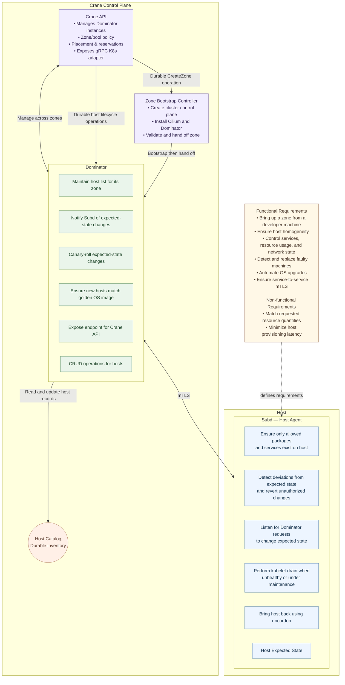

# Crane + Kubernetes: Implementation Plan

**Status:** Draft | **Language:** Go | **Target:** AWS EC2 (first milestone)

## 1. Executive summary

Crane is the infrastructure control plane underneath Kubernetes—not a second developer-facing platform. Developers deploy workloads using standard Kubernetes resources. The Kubernetes scheduler and Cluster Autoscaler determine when additional capacity is needed. For node autoscaling, Crane API validates the autoscaler-selected, cluster-scoped node group and atomically reserves credits; it never redirects a request to another cluster or zone. A layer-zero Zone Bootstrap Controller creates new zone clusters, Dominator executes zone-scoped host lifecycle operations, Subd enforces host-local state, and the Host Catalog provides durable cross-zone inventory. Observability is treated as a horizontal requirement.

Application teams must never call Crane APIs directly. All capacity changes flow through the Cluster Autoscaler external gRPC provider adapter.

## 2. Reference architecture

The component structure below is canonical. Every decision maps back to these components.



**Structural consequences:**

1. **Crane API is the single policy and capacity authority.** The per-cluster autoscaler selects a node group. Crane validates that selection and global policy; it does not redirect the request to another cluster or zone. Dominator executes zone-scoped work.
2. **Dominator is zone-scoped; Subd is host-scoped.** Control plane owns decisions, data plane enforces state.
3. **Host Catalog is durable inventory, not a cache.** Fleet state is reconstructible from durable records.
4. **Per-zone clusters; layer zero is outside the zone.** Each zone is its own Kubernetes cluster with its own control plane/API endpoint. Identity and control-plane bootstrap (SPIRE, Crane's Postgres, `crane-api`, and the Zone Bootstrap Controller) live in layer zero and are not run on capacity being provisioned (see §5.1).

## 3. Component responsibilities and ownership

### 3.1 Developer experience

Developers use standard Kubernetes (`Deployment`, `StatefulSet`, `Job`, `Pod`, `ResourceQuota`, affinity, topology spread, taints/tolerations). They must not call Crane APIs, choose instance IDs, or manage host lifecycle.

### 3.2 Key ownership

| Responsibility | Owner |
|---|---|
| Workload scheduling | Kubernetes scheduler |
| When nodes needed | Kubernetes node autoscaler |
| Validate autoscaler-selected group, global policy, credit enforcement | Crane API |
| Create and validate new zone clusters | Zone Bootstrap Controller on layer-zero/platform capacity |
| Provision/repair/terminate (zone) | Dominator |
| Cross-zone inventory | Host Catalog |
| Kubernetes cordon, eviction, drain completion, uncordon | Dominator |
| Host-local preparation and expected-state enforcement | Subd |

## 4. Architecture decisions (core)

- **A.** Kubernetes owns workload scaling (HPA + autoscaler).
- **B.** Crane owns machine capacity; autoscaler adapter requests capacity changes.
- **C.** Use standard Kubernetes topology primitives.
- **D.** CRDs describe policy; autoscaler/provider does imperative scale.
- **E.** Credits enforced atomically at Crane API boundary. Credits track only machines Crane has allocated (pending and provisioned nodes) against the team budget; observed workload allocation is informational and does not itself draw down credits.
- **F.** Each Cluster Autoscaler manages exactly one Kubernetes cluster and may select only node groups with that `ClusterID`. Crane honors the selected group. There is no cross-cluster or cross-zone fallback within a node-capacity request.
- **G.** Capacity = reserved (not raw free) resources.
- **H.** Golden images/rollouts are version-pinned (not "latest").
- **I.** Capacity is a state progression (`requested → provisioning → booting → registering → converging → ready → draining → terminating → terminated/failed`). Registration alone is not readiness.
- **J.** Control plane gets full observability; Subd reports outcome via heartbeat only (no streaming telemetry).

## 5. Kubernetes integration

**Prefer Cluster Autoscaler external gRPC provider.** The CA external gRPC `IncreaseSize`/`DecreaseTargetSize` calls do **not** include idempotency keys. The adapter therefore must not attempt to infer a stable "autoscaler decision" key from `(group, delta)`. It converts each received RPC into a revision-checked target mutation. A handler-scoped request UUID deduplicates adapter→Crane retries for that RPC; target refresh and reconciliation recover when the adapter dies before returning a response. Pending-pod aggregation remains in the autoscaler; the adapter only translates decisions.

Adapter responsibilities: expose only groups belonging to its Kubernetes cluster; discover groups with identity/zone/class/template revision; report target/actual; translate increase/decrease by group ID; delete explicitly named nodes per contract; return the selected group's simulated node template; report instance state with group ownership; and map provider errors safely. The adapter must pass the autoscaler-selected `NodeGroupID` through to Crane.

### 5.1 Layer zero and cluster ownership

Layer zero is identity plus the control-plane bootstrap, brought up **before any zone exists**:

1. **SPIRE server + its PostgreSQL (RDS)** — provisioned manually from a developer's machine per [`docs/spire-server-ec2-setup.md`](spire-server-ec2-setup.md). No cloud hosts exist beforehand. This remains the one manual step whenever no infrastructure exists.
2. **The first zone** — a Kubernetes cluster built with kubeadm that hosts `crane-api` and the Dominator that owns that zone. The first zone is always the **platform team's cluster**.
3. Once at least one `crane-api` is running, **subsequent zones are brought up by calling the Crane API**. A Zone Bootstrap Controller running on protected layer-zero/platform capacity executes the operation; the destination Dominator cannot bootstrap the cluster in which it will run.

Layer-zero components (SPIRE, Postgres, `crane-api`) must not run on capacity being provisioned, preserving an independent bootstrap path (cf. Uber's Crane, which keeps layer-zero dependencies outside the zone being assembled).

Each zone is a **separate Kubernetes cluster**; `crane-api` tracks one cluster record per zone.

The Zone Bootstrap Controller owns a durable `CreateZone` state machine:

```text
Requested
→ InfrastructureProvisioning
→ ControlPlaneInitializing
→ NetworkInstalling
→ DominatorInstalling
→ Validating
→ Ready
→ Failed
```

It provisions control-plane hosts, coordinates `kubeadm init`, records the API endpoint and CA discovery hash, obtains scoped administrative access, installs Cilium and required platform components, deploys the destination Dominator, and verifies that Dominator is authenticated and healthy. Only then does it hand routine zone execution to Dominator and allow worker node groups in that zone.

### 5.2 Node join and readiness

- **Join mechanism:** `kubeadm`. Workers join their zone's cluster via `kubeadm join`, using the zone's cluster record (API server endpoint, CA cert hash, bootstrap token).
- **Token flow:** the Zone Bootstrap Controller or destination Dominator uses authenticated access to the destination Kubernetes API to create a short-lived `bootstrap.kubernetes.io/token` Secret. Dominator delivers the token to Subd over the authenticated control-plane→host channel. Tokens are never handed to applications, and plaintext tokens are not retained after use.
- **CNI:** **Cilium**.
- **Registering** means `kubeadm join` is in progress. **Converging** means the Kubernetes `Node` exists but platform requirements are incomplete. **Ready** is set by Dominator's trusted Kubernetes watcher only after the Node has `Ready=True`, `NetworkUnavailable` is absent or `False`, its provider/group/pool/region/zone identity matches the Host Catalog, Subd reports the assigned expected-state version, and the required Cilium agent is healthy. The node remains cordoned or carries a provisioning taint until validation completes. Subd cannot declare itself ready.

## 6. API and data model essentials

- **Zone**: canonical Crane zone ID, provider/account/region, `ProviderZoneID`, enabled/status. Unique `(provider,account_id,region,provider_zone_id)`.
- **Cluster** (one per zone): `ID`, `ZoneID`, `APIServerEndpoint`, `CACertHash` (discovery trust root), kubeadm/kubelet version, container runtime, `CNI` (Cilium), bootstrap/join configuration, `LifecycleState`. `crane-api` owns cluster records; the bootstrap controller or Dominator creates join-token Secrets through the destination Kubernetes API.
- **ZoneBootstrapOperation**: `ID`, `ZoneID`, immutable bootstrap parameters, phase, lease/fencing metadata, last error, timestamps. It is owned by the layer-zero Zone Bootstrap Controller until validated handoff.
- **NodeGroup** (contract unit): `ID`, `ClusterID`, `NodePoolID`, `ZoneID`, `CapacityClass`, `ProviderZoneID`, `TargetNodes`, `TargetRevision`, `MinNodes`, `MaxNodes`, `TemplateRevision`, `LifecycleState`. One pool may back multiple cluster-scoped groups, but an autoscaler sees only groups with its `ClusterID`.
- **CapacityRequest**: `NodeGroupID` (required), handler-scoped `RequestID`, `ExpectedTargetRevision`, `DesiredTarget`, `TemplateRevision`. `(NodeGroupID, RequestID)` deduplicates only retries made while handling one external RPC.
- **CreditReservation**: `TeamID`, `NodeGroupID`, `CapacityRequestID`, VCPU/Memory/NodeCount, `State`. Reservation mutation is part of the target transaction and is deduplicated by the associated `(NodeGroupID, RequestID)`.
- **NodeRemovalOperation**: explicit `NodeGroupID`, host/node/provider identities, reason (`autoscaler-delete`, `repair`, `maintenance`), whether desired capacity is preserved, drain deadline/status, lease/fencing metadata, provider termination status.
- **Host Catalog**: host identity, placement (`node_group_id`, `node_pool_id`, `crane_zone`), lifecycle/health, `desired_state_version`/`observed_state_version`, allocatable/reserved, `operation_id`, `last_heartbeat_at`. Hosts cannot self-assign placement/ownership.

## 7. Placement

- **Node group topology:** logical pool → cluster-scoped group for one (zone, capacity class). Group identity is part of the capacity contract, and its `ClusterID` must match the calling autoscaler.
- **Pod placement:** standard `topologySpreadConstraints`, `podAntiAffinity`, `nodeAffinity`/`nodeSelector`, taints/tolerations, and storage topology apply within one zone cluster. Cross-zone application availability requires a separate multi-cluster deployment and traffic-management layer and is outside the first milestone.
- **Zone failure:** mark the cluster/zone unavailable for new provisioning, do not auto-terminate healthy nodes on transient discovery failure, and surface a degraded condition. A different zone cluster cannot satisfy Pods pending in the failed cluster.
- **Cluster placement:** zone selection applies when creating a new cluster or when a future multi-cluster placement layer chooses a workload cluster. It is not repeated during a node scale-up request.

## 8. Scale-up flow

1. Workload applied; scheduler leaves unschedulable Pods.
2. CA aggregates pending demand, simulates eligible groups, selects a compatible group.
3. Adapter reads the current target and revision, computes `DesiredTarget = current target + delta`, generates a handler-scoped `RequestID`, and calls Crane with `NodeGroupID`, `ExpectedTargetRevision`, and `DesiredTarget`.
4. Crane validates that the group belongs to the adapter's cluster and is active, its template revision is compatible, and pool/team/budget/group limits permit the change. It uses compare-and-set against the target revision.
5. Crane atomically writes the new target revision, reserves only the increment, and creates durable provisioning operations keyed by `(NodeGroupID, RequestID)`. A retry from the same handler returns the existing outcome. A CAS conflict requires a target reread; `(group, delta)` is never used for deduplication.
6. Crane dispatches to the Dominator owning that zone. If the group is invalid, reject with a precise reason; CA may independently reevaluate other compatible groups exposed for the same cluster.
7. Dominator provisions via cloud provider; Subd enrolls, applies versioned expected state, and joins the zone's cluster via `kubeadm`. Registration moves the host to `converging`; Dominator marks it `ready` and removes the provisioning taint/cordon only after the §5.2 readiness gates pass.
8. Autoscaler sees nodes; Pods schedule. Crane reconciles status/inventory and emits audit/metrics events.

Scale-up is asynchronous (accepted ≠ ready). Define timeouts, retries, observable states.

## 9. Capacity reduction, node deletion, repair, and maintenance

These are separate durable operations.

### 9.1 `DecreaseTargetSize`: cancel unfulfilled capacity

1. CA requests a negative target delta for a specific group. This operation must not delete an existing Kubernetes node.
2. The adapter performs the same revision-checked target mutation used for scale-up.
3. Crane atomically lowers the target and cancels only unclaimed or pre-registration provisioning operations.
4. If a provider launch is already irreversible, record the resulting host as excess capacity. Reconcile it through a later explicit node-removal operation rather than silently selecting a ready node.
5. Release a reservation only when its provisioning operation is safely cancelled or its provider instance is actually released.

### 9.2 `DeleteNodes`: remove explicitly named nodes

1. CA determines that named nodes can be removed, considering cooldowns, local storage, PDBs, and minimum group capacity.
2. Crane verifies every node belongs to the stated group, atomically lowers the target, and creates one durable `NodeRemovalOperation` per node.
3. Dominator is the sole Kubernetes drain coordinator. It cordons the node, performs eviction, and records blocking Pods/PDBs. Subd performs requested host-local preparation and reports its outcome.
4. A blocked drain retries with backoff until its deadline. The node remains cordoned while active; expiry reports a blocked operation and does not terminate the instance.
5. After eviction completes, Dominator terminates the provider instance, marks the host terminated, and releases its credits.

### 9.3 Repair and maintenance

Repair and maintenance use explicit host identities and the same drain coordinator. The operation records whether desired group capacity must be preserved. When availability policy requires replacement, reserve and provision replacement capacity before removing a reachable degraded host. Confirmed-dead or unreachable hosts follow a separately authorized force-removal policy because Subd cannot prepare them and eviction may be impossible. Maintenance, repair, and autoscaler deletion acquire exclusive operation ownership for a host so they cannot race.

## 10. Failure handling & consistency

- **Single durable authority:** PostgreSQL is the one source of truth for a capacity mutation. One transaction atomically writes the target revision, credit reservation, host intent, and executable operation, then commits. Dominator claims and reconciles those persisted operations; it must not "copy" them into a second authority. The Host Catalog is inventory derived from these records, not a competing writer.
- **Database placement:** for the first milestone, Crane's operational database shares the same RDS instance as SPIRE (the `crane` database); there is no separate PostgreSQL deployment yet.
- **Adapter request idempotency:** `(group_id, request_id)` uniqueness deduplicates downstream retries made by one live external-RPC handler. It does not identify an autoscaler decision and `(group_id, delta)` is never a key. A later identical delta is a new intent.
- **Provider idempotency:** persist a provider idempotency token (AWS `ClientToken`) and immutable launch parameters with each provisioning operation so provider retries cannot launch a second instance.
- **Recovery on lost response:** a live handler retries with its `RequestID`. If the adapter dies after commit, Cluster Autoscaler reads the committed target through `TargetSize`; reconciliation uses the persisted target revision, operation progress, and cloud inventory rather than blindly reapplying a delta.
- **Target-first:** persist target + operation before external side effects; survive restarts.
- **Operation ownership:** operations carry leases; a stale/expired controller is fenced from acting. Abandoned work is recovered, and an operation is cancelled when a newer target supersedes it. Leader election alone does not prevent delayed side effects from an old controller.
- **Concurrency:** CAS on target revisions; transactional reservations; cannot exceed budget/overallocate zone.
- **Partial provisioning:** handle launch success + lost response via inventory/operation state.
- **Reconciliation:** periodic compare of desired/DB/Host Catalog/cloud/K8s Nodes.
- **Safety:** group exhaustion is surfaced to the autoscaler; a group in another zone cluster cannot satisfy the request. Safe drain respects PDBs/minimum capacity and never terminates merely because a drain deadline expired. Credit reconciliation follows actual lifecycle state. Heartbeat freshness is a signal, not proof of death during partitions.

## 11. Security (high level)

- Developers use K8s RBAC only. Platform owns `CraneNodePool`/quotas.
- Adapter authenticates to Crane with scoped identity; do not trust client-supplied team identity.
- mTLS + scoped authorization for Crane→Dominator, Dominator→Subd, adapter→Crane, control-plane→catalog. Authentication ≠ authorization.
- Hosts prove identity at enrollment (cloud instance identity/bootstrap). Keep cloud creds in control plane.
- Audit capacity changes, rollouts, drains/terminations, quota denials, zone selections, launches.

## 12. Observability (brief)

- **Control plane** (crane-api, dominator): structured logs (slog), OTLP traces/metrics, audit trail.
- **Data plane** (subd): structured local journald logs + heartbeat outcome reporting only; no streaming telemetry, no open listener.
- Redact secrets in logs; replace `log.Fatal` in library paths with returned errors; propagate `request_id`/trace context; liveness/readiness split; inject `version`/`commit`.

## 13. Testing strategy (key)

- **Unit:** zone resolution, node-group/template validation, CAS/target updates, transactional reservations, idempotent replay, lifecycle transitions, logging redaction.
- **Contract:** CA external gRPC adapter against exact upstream release (including group identity, template revisions), mTLS/auth boundaries.
- **Integration/E2E:** aggregated pending demand → one request; downstream retry with one `RequestID`; adapter crash after commit followed by `TargetSize` refresh; two legitimate equal deltas; CAS conflict; provider lost-response recovery; target cancellation without deletion of ready nodes; explicit-node deletion; blocked PDB and unreachable-host behavior; automated zone bootstrap and handoff; restart recovery; audit events present.

## 14. Phased implementation plan

### Phase 0 — Architecture & compatibility spike
- Pin K8s/CA/external gRPC/kubeadm versions, container runtime, and **Cilium** as CNI; confirm NodeGroup scope (per zone + per capacity class) and one-cluster-per-zone topology.
- Define the **cluster record** and `ZoneBootstrapOperation` contracts, bootstrap state machine, handoff gate, and join-token flow through the destination Kubernetes API.
- Define handler-scoped adapter `RequestID`, revision-checked `SetTarget`, replay/recovery rules, and provider-token scope. Confirm behavior with the pinned CA release for lost responses, adapter restart, equal consecutive deltas, and CAS conflict.
- Decide credit semantics (capacity entitlement vs cost) and bootstrap identity. Dominator is the Kubernetes drain coordinator; Subd owns host-local preparation.
- Exit: ADR covering the above; minimal adapter reports a cluster-scoped static group/template; compatibility tests prove target refresh/recovery semantics for the pinned CA release.

### Phase 1 — Control-plane data model & structured logging foundation
- Models: `Zone`, `NodeGroup`, `NodePool`, `CapacityRequest`, `CreditReservation`. Host Catalog schema with lifecycle states, desired/observed versions, allocatable/reserved, operations.
- Add `ZoneBootstrapOperation` and `NodeRemovalOperation`; enforce `(group_id, request_id)` uniqueness and target revisioning in persistence.
- Implement the single-transaction mutation boundary: one PostgreSQL transaction writes target revision + credit reservation + host intent + executable operation; operation leases, stale-controller fencing, supersede cancellation, and provider idempotency token persisted with the operation.
- slog migration with redaction, OTLP init (no-op fallback), `gofmt`/`go vet`/`go test` in CI.
- Exit: durable state models compile; the atomic mutation boundary is proven by tests (no partial writes); control-plane binaries use structured redaction-safe logging.

### Phase 2 — One zone end-to-end
- Assume layer zero exists (SPIRE + Postgres + a running `crane-api` in the platform team's first zone); subsequent zones are created via the Crane API.
- Implement adapter-to-Crane target protocol (handler `RequestID`, target revision CAS, replay, lost-response and adapter-crash recovery).
- Provider-backed create/delete, per-zone cluster record, zone-scoped Dominator reconciler, Subd enrollment via `kubeadm join` (Cilium), endpoint/reporting.
- Implement the Zone Bootstrap Controller and use it to create one subsequent zone: provision control plane, run `kubeadm init`, install Cilium/Dominator, validate, and hand off.
- Audit events on bootstrap and catalog transitions. Include lost autoscaler and provider response recovery tests (fake/LocalStack).
- Exit: one request provisions one node → Subd enrolls and runs `kubeadm join` → node registers, converges, becomes Kubernetes Ready, and has its provisioning taint/cordon removed; downstream retry returns the same outcome; adapter crash recovers via target refresh; one subsequent zone reaches validated handoff.

### Phase 3 — Credits & authorization
- Transactional reservation ledger, concurrency-safe budget checks, replay semantics.
- Trusted team/cluster/pool identity; quota-denial reasons + audit.
- mTLS + scoped authorization (adapter→Crane, Crane→Dominator, Dominator→Subd), periodic reconciliation.
- Exit: concurrent requests cannot exceed budget; retries with the same handler `RequestID` do not create new reservations; two legitimate equal deltas both apply; all pending/provisioned instances are accounted for.

### Phase 4 — Autoscaler adapter & cluster-scoped capacity policy
- CA external gRPC adapter: group discovery, templates, target/actual, increase/decrease by group ID.
- Expose only groups for the adapter's `ClusterID`; honor the selected `NodeGroupID`; aggregated demand remains in CA.
- Validate group/cluster/zone consistency, reserve capacity transactionally, and enforce Dominator zone ownership. Do not rank or redirect to another zone cluster.
- Exit: unschedulable Pod → aggregated CA request → adapter → Crane → node ready; app teams never call Crane directly.

### Phase 5 — Scale-down, repair & hardening
- Implement distinct `DecreaseTargetSize` cancellation and explicit `DeleteNodes` workflows. Cancellation never deletes a ready node; irreversible launches become observable excess capacity.
- Dominator owns cordon/eviction/drain completion; test blocked PDBs, expired drain deadlines, unreachable Subd, cancellation during launch, and exclusive host operation ownership. Terminate only after the applicable safety gate; release credits **after actual termination**.
- Failure detection, replacement, orphan reconciliation, controller restart recovery from durable state.
- Per-zone cluster outage handling, credit leak prevention, and replacement-at-quota tests. Cross-cluster workload failover remains out of scope.
- Exit: safe scale-down, restart recovery works, no credit leaks on failures/retries.

### Phase 6 — CRDs, golden-image rollouts & production readiness (consolidated)
- `CraneNodePool` CRD + validating RBAC/admission; controller validation/status.
- Version-pinned golden-image/expected-state rollouts with canary + Subd convergence reporting.
- Health (liveness/readiness), version/commit injection, metrics/traces hardening, runbooks, pilot readiness.
- Exit: policy declared via K8s CRDs; rollouts version-pinned and observable; fleet converges under failures.

## 15. Open questions (resolve before API freeze)
1. NodeGroup scope: per (zone, capacity class) only, or other combinations?
2. Credit model: capacity entitlement, cost budget, or both?
3. Bootstrap identity: mechanism for nodes to prove identity on enrollment? (Layer zero provides SPIRE with AWS instance-identity attestation — confirm this is the enrollment path.)
4. Force-removal policy: which confirmed-dead-host conditions and actor authorization permit bypassing normal drain completion?
5. Subd reporting boundary: local journald + heartbeat outcome only; no streaming telemetry—confirm acceptable?

## 16. Definition of Done
- Layer zero (SPIRE + Postgres + `crane-api`) is bring-up-able from a developer machine; subsequent zones are created through the Crane API.
- The Zone Bootstrap Controller creates a subsequent cluster through `Ready`, then hands routine execution to its authenticated Dominator before worker provisioning is enabled.
- A K8s-only workflow triggers aggregated capacity requests; each external RPC becomes a revision-checked target mutation with a handler-scoped `(group_id,request_id)` retry key.
- No double-provisioning or double-reserving on downstream/provider retry; adapter loss recovers through target refresh; two legitimate equal deltas remain distinct intents.
- Credits reserved atomically in the same PostgreSQL transaction that writes the target revision, host intent, and executable operation; released only after actual termination; no leaks on restarts/failures/partial launches.
- Operations are leased and fenced: a superseded or stale controller cannot apply delayed side effects.
- Nodes join their per-zone cluster via `kubeadm`; registration and convergence are distinct from readiness. Dominator declares ready only after Kubernetes Ready/network, identity/labels, expected-state, and Cilium gates pass.
- Each autoscaler sees only groups for its cluster. The selected group is always honored, and a node-capacity request is never redirected to another cluster or zone.
- `DecreaseTargetSize` cancels only unfulfilled capacity; `DeleteNodes` removes named nodes. Dominator solely owns Kubernetes cordon/eviction/drain, and blocked drains do not terminate instances implicitly.
- Structured, redaction-safe logs; liveness/readiness; basic OTLP telemetry; `gofmt`/`go vet`/`go test` pass in CI.
- Capacity changes, drains/terminations, rollouts, quota denials, zone selections are auditable end-to-end.
- Subd observable via local journald + heartbeat outcome; no streaming telemetry or open listeners.
